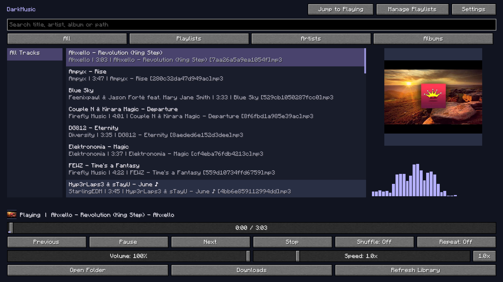

# DarkMusic


[](https://github.com/DarkLian/DarkMusic/actions/workflows/build.yml)
[Download the latest release](https://github.com/DarkLian/DarkMusic/releases/latest) · [Source code](https://github.com/DarkLian/DarkMusic)

**Your music, inside Minecraft.** Play your collection, edit playlists, download authorized audio, and keep listening across menus and worlds.

- MP3, OGG Vorbis, PCM WAV, and FLAC, with embedded metadata and artwork.
- Search by title, artist, album, or path; browse collapsible subfolders, playlists, artists, and albums; jump back to the playing song's original list.
- Bulk playlist selection and animated reordering of connected selections.
- Volume, seeking, shuffle, repeat, and playback speed from **0.5x to 3.0x**.
- A combined now-playing HUD with optional artwork, progress, and real audio spectrum bars.
- One settings screen with a live HUD preview, background transparency, and drag/scroll layout editing.
- Independent spectrum/progress color presets and custom solid or mixed colors; the original purple stays the default.
- URL analysis, searchable collection previews, short audio previews, download queues, and optional verified tool installation.
- English and Traditional Chinese, following Minecraft's language setting.



*Original fullscreen capture at Minecraft GUI scale 3.*

## Requirements

| Component | Version |
|---|---|
| Minecraft Java Edition | **26.2** |
| Fabric Loader | **0.19.5+** |
| Fabric API | **0.161.0+26.2** |
| Java | **25+** |

## Install and listen

1. Add Fabric API for Minecraft 26.2 and **darkmusic-1.0.3.jar** to a Fabric instance's `mods` folder.
2. Launch Minecraft and click **Music** on the title screen, or press **B** during gameplay.
3. Click **Open Folder**, then copy supported audio into that folder. Subfolders are included.
4. Wait for discovery or click **Refresh Library**, then double-click a song.

The default folder is `config/darkmusic/music` inside the active Minecraft instance. To choose an existing collection, open **Settings → Choose Music Folder** and select a directory in the desktop folder chooser. Its path appears below that option. No files are moved.

**`/da`** or **`/darkmusic`** opens the player, **`/da gui`** opens Edit HUD Layout, and **`/da help`** shows local tips and useful links. Both aliases support all subcommands. These commands execute client-side; help is added locally rather than sent as chat.

**Escape** closes the current screen. Settings save automatically; music continues when you close the player.

## Default shortcuts

Change these in **Options → Controls → Key Binds → DarkMusic**.

| Action | Default |
|---|---|
| Open music player | **B** |
| Play / pause music | **Backslash (`\`)** |
| Previous / next song | **`[` / `]`** |
| Decrease / increase volume | **Down Arrow / Up Arrow** (5% per press) |
| Decrease / increase speed | **Left Arrow / Right Arrow** (0.1x per press) |
| Mute / unmute | **M** |
| Reset playback speed | **Numpad 0** |

Shortcuts work during gameplay with menus closed. Volume, mute, and speed shortcuts show brief fading feedback. Saved bindings stay unchanged until reset.

## Settings and HUD

General and HUD options share one screen. Defaults are **Now-Playing HUD on**, **100% volume**, **100% HUD scale**, **0% background transparency**, and **36 bars**, placed **below** the song information/progress and growing **upward**.

Artwork, progress, and spectrum have individual toggles. The master switch hides the whole gameplay HUD; **Music Spectrum** controls bars in both the player and HUD. Smoothing, sensitivity, bar count, placement, and direction are in the HUD section. Player bars use their own main-menu area.

**Spectrum Colors** and **Progress Bar Colors** offer Moonlight (the original purple), Aurora Borealis, Neon Dream, Solar Flare, Ocean Drive, Sakura Sky, Glacier Glow, Ruby Pulse, and Custom Mix. Enter matching hex colors for a solid color or different endpoints for a blend. Choices apply to the HUD and player.

The live preview updates immediately. Scroll over it to resize its independent preview; a percentage readout helps compare sizes. Use **Edit HUD Layout** to drag the actual combined HUD or scroll over it to resize in 10% steps. There is no separate spectrum layout editor.

**Reset to Defaults** asks for confirmation, then restores preferences/key binds, switches to the default folder, stops pending work, removes instance-local tools and recognized download records, and clears caches. **Audio/video files, downloaded music, playlists, and external tools are preserved.** Unknown or linked files are retained and reported.

## Download music in-game

Open **Downloads → Tools → Install / Update Tools** to explicitly install a verified instance-local bundle. Tools are listed separately:

- [yt-dlp](https://github.com/yt-dlp/yt-dlp): extraction and supported-site handling.
- [FFmpeg](https://ffmpeg.org/): MP3 conversion and metadata/artwork embedding.
- [FFprobe](https://ffmpeg.org/ffprobe.html): output validation.
- [Deno](https://deno.com/): YouTube JavaScript support; a compatible Node.js installation can also be used.

Nothing installs during normal startup. **Advanced Paths** supports existing executables and system tools. YouTube needs Deno 2.3+ or Node.js 22+; see [yt-dlp's JavaScript guide](https://github.com/yt-dlp/yt-dlp/wiki/EJS). External tools are not in the mod JAR and are unnecessary for local playback.

Paste a video or collection URL and **Analyze**. Choose **This Video Only**, **Selected Entries**, an inclusive **Entry Range**, or explicitly **All Entries**. Search filters the loaded page. Range mode uses only its inputs; switching modes clears checks. A single result defaults to This Video Only. Nothing downloads until you click **Download**.

**Play Audio Preview** lets you listen to up to 30 seconds before deciding. Leaving Downloads keeps the URL and analyzed preview while stopping temporary audio playback. Entries and Queue have separate search filters. Queue disables Mode/Download and enables only applicable actions. Three downloads run concurrently; failed downloads retry after the queue finishes, up to three additional attempts. Retry Selected/Retry Failed allow manual retries. Clear Finished preserves failures; use Clear Failed to remove those rows. A gameplay overlay shows queue progress and fading completion/failure notices. Queued downloads continue after closing the menu. Finished MP3s remain in the selected folder and appear without restarting.

Download only content you are authorized to save. Support and access depend on yt-dlp and the source site; DarkMusic does not bypass access controls.

See the **[user guide](docs/USER_GUIDE.md)** for selection behavior, metadata, troubleshooting, and reset details.

## Build from source

Use a Java 25 JDK:

```powershell
# Windows
.\gradlew.bat build
```

```sh
# Linux / macOS
./gradlew build
```

Install `build/libs/darkmusic-1.0.3.jar`. The `-sources.jar` and `-third-party-sources.zip` are source archives, not installable mods. Include third-party sources and notices when redistributing builds.

See **[testing and screenshots](docs/TESTING.md)** and **[v1.0.3 release notes](docs/RELEASE-1.0.3.md)**.

## License

DarkMusic is **[CC0-1.0](LICENSE)**. Libraries retain their licenses; see the **[third-party notices](src/main/resources/THIRD-PARTY-NOTICES.md)**. Personal music and artwork are not bundled.
