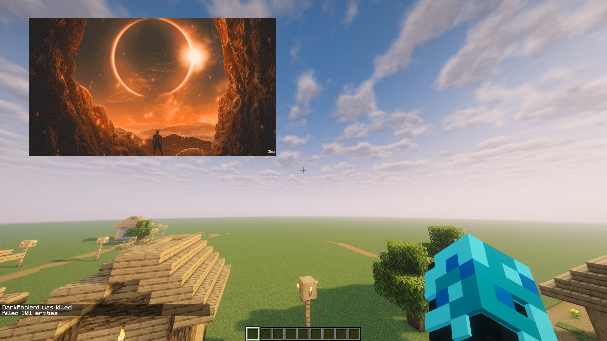

# DarkMusic

Your own music library, inside Minecraft. Browse and play your collection, build playlists, download songs without leaving the game, shape the sound, and show it all on an audio-reactive HUD. Optionally, watch another window in a Picture-in-Picture view while you play.


## Install

DarkMusic **v3.1.2** needs **Minecraft 26.2**, **Java 25**, **Fabric Loader 0.19.5 or newer**, and **Fabric API for Minecraft 26.2**.

1. Download `darkmusic-3.1.2.jar` from [GitHub Releases](https://github.com/DarkLian/DarkMusic/releases/latest).
2. Put it and Fabric API in your instance's `mods` folder.
3. Start Minecraft and press **B** to open DarkMusic.
4. Add your songs under **Settings → General → Music Folders**, drag audio files into the player, or copy them to `config/darkmusic/music` in your instance.

DarkMusic runs on the client only; servers do not need it. The music player works on Windows, Linux, and macOS. Downloading and some audio formats need extra tools, which DarkMusic can install for you (see [Download music](#download-music)).

New to DarkMusic? The [User Guide](docs/USER_GUIDE.md) covers every screen and setting.

## Highlights

- **Your library, your way.** Add several music folders and browse by folder, playlist, artist, or album. Search titles, artists, albums, and paths.
- **Playlists and favorites.** Select songs in bulk, drag to reorder, and keep favorites one heart-click away.
- **Up Next.** Play a song next or add it to a temporary queue without touching your playlists.
- **Now-Playing HUD.** Classic, Circular, Artwork, or Spectrum Only, with lyrics, a progress bar or full-song waveform, and your own colors and position.
- **Sound Environments and Audio Options.** 23 environments, EQ, loudness normalization, crossfade, gapless playback, and a live Audio Analyzer.
- **In-game downloads.** Paste a video or playlist link, preview it, and pick what to save.
- **Lyrics.** Synchronized or plain lyrics for songs already in your library.
- **Smart Cleanup.** Find possible duplicates and decide for yourself what to keep. Nothing is deleted automatically.
- **Picture-in-Picture (optional, Windows x64).** Bring another application window into Minecraft.

## Play your music

Browse your collection, search, shuffle, repeat, seek in five-second steps, and change speed from 0.5× to 3.0× (pitch is preserved). **Jump to Playing** takes you back to the collection a song came from. Pick your headphones or speakers under Audio Options, or stay on System Default.

Other everyday tools:

- **Edit song details.** Change title, artist, album, and filename with the pencil button. Open or copy a song's source link when one is available.
- **Import.** Drag audio files into the player or playlist manager. Review results in Import History.
- **Listening history.** The clock icon beside Manage Playlists shows Recently Played, Most Played, play counts, and listening time.
- **Backup and restore.** Export settings, playlists, key bindings, and listening history to a ZIP, then preview and choose what to restore. Your audio files are never included or changed.
- **Manage Audio Files.** Review files individually or in bulk and move them to Trash. Permanent deletion needs its own confirmation.

## Build your playlists

Create playlists, bulk-select songs, and drag connected selections to reorder them.


## Decide what plays next

Open Song Actions on a song to choose **Play Next** or **Add to Queue**. Open **Up Next** to see what is playing and what is coming, then drag to rearrange or remove entries. When your queue ends, the original collection continues.


## Show your music in the game

Choose a **Classic**, **Circular**, **Artwork**, or **Spectrum Only** HUD. Pick bars, waves, or spikes, add gradients, glow, trails, and peak markers, and optionally turn on a **waveform progress bar** that shows the real shape of the song (**Settings → HUD → Progress Bar**). Move and resize everything in **Edit HUD Layout**.


Preview layouts live and pick a gradient or your own colors with a color spectrum, RGB sliders, or hex values.


## Shape your sound

Open **Sound Environment** from **Settings → Audio** and pick one of **23 environments**, from Car Cabin and Stairwell to vinyl warmth and Orbital Echo. Adjust its intensity, save your own variations, and combine it with Audio Options.


**Audio Options** offers Music, Gaming, Vocal, and Night profiles, loudness normalization, graphic or parametric EQ, compression, reverb, gapless playback, crossfade, and more. The **Audio Analyzer** lets you see your sound and compare settings with A/B listening.


## Follow along with lyrics

Turn on lyrics in **Settings → Lyrics** and approve online lookup. DarkMusic searches [LRCLIB](https://lrclib.net) for the song you play and applies the first reliable match; alternatives stay available. **Find Missing Lyrics** checks your whole collection, but only when you start it. Your own lyric files and embedded lyrics keep working.

Adjust timing for individual songs, and move and resize the lyrics HUD separately in every layout. Lyrics language is independent of Minecraft's interface language.

## Download music

Paste a video or playlist link under **Downloads**, analyze it, and select entries or a range. Preview songs before queueing them, and download several at once with progress and retries. If something fails, **Error Details** explains why and what to try, and lets you copy a safe report.


DarkMusic notices when a source video is already in your library, so you can skip it or choose **Download Anyway**.

Under **Downloads → Tools**, choose **Install / Update Tools** for automatic setup of yt-dlp, FFmpeg/FFprobe, and Deno. Existing installations can be selected under **Advanced Paths**. The installer supports Windows x64 and Linux/macOS x64 or ARM64; Windows ARM64 needs compatible tools installed by you. Which sites work depends on yt-dlp. Save only content you have permission to download.

## Find duplicates

Open **Manage Audio Files → Smart Cleanup** to find related recordings, even when filenames, tags, or formats differ. Compare artwork and file details, play version A or B, then keep both, ignore the match, or review a file for deletion.


## Watch another window while you play (optional)

**Picture-in-Picture** shows a selected application window inside Minecraft, even in fullscreen. It is for **Windows x64** only and is entirely optional. The main mod is only about 4 MB, and PiP's extra runtime is installed on request.

1. Click the **PiP icon** beside Manage Audio Files (or run `/da pip`).
2. Choose **Check PiP Requirements**, then **Install PiP Dependencies**.
3. Choose **Enable PiP Access**, pick a window, and start capture.

Move, resize, and crop the view, change its opacity, press **Ctrl+Alt+F8** to operate the source application, and **Ctrl+Alt+F9** to return to Minecraft. Use Minecraft's own non-exclusive fullscreen or windowed mode while capturing; exclusive fullscreen and the Cubes Without Borders mod can cause screen tearing. Keep the source window open and not minimized. Capture never starts by itself, and disabling PiP Access stops it immediately.

Turn on **PiP Audio Spectrum** to visualize that application's sound with its own styles and colors. Sound still plays through the source application, independently of DarkMusic.



PiP follows the frame limit you choose; on one tested system a 144 FPS limit delivered about 143 FPS. Smoothness still depends on Windows, the source application, and your graphics hardware, so no particular frame rate is promised. It needs Windows build 19041 or later (20348 or later for the audio spectrum). Details are in the [setup guide](docs/PIP-OPTIONAL-INSTALLATION.md), [verification notes](docs/PIP-VERIFICATION.md), and [performance measurements](docs/PIP-PERFORMANCE.md). The native helper and runtime are installed together only when you approve PiP installation; the main JAR contains their installation manifest. Do not put the optional dependency ZIP from the release page in `mods`; use the in-game installer.

## Updates

Automatic update checks are on by default: they run after joining a world/server and every six hours while connected. Notifications appear once per launch after you join a world or server. Click **Update** to approve a download, then close Minecraft to finish installing. You can also use **Settings → General → Check for Updates**. Your settings, library, playlists, and assets are kept. If installation fails, the next launch tells you and offers the log.

## What's new

**v3.1.2** lists Cubes Without Borders as a conflicting mod and warns in PiP settings whenever Exclusive Fullscreen is on. Both cause screen tearing while PiP captures; Minecraft's own non-exclusive fullscreen does not ([notes](docs/RELEASE-3.1.2.md)).

**v3.1.1** moves the Windows PiP helper into the optional installation package. The main mod JAR contains no native helper binaries. Existing PiP users install the new matching package through the PiP menu; settings and access permissions are preserved ([release notes](docs/RELEASE-3.1.1.md)).

**v3.1.0** improves large-library search, Opus metadata and lyrics, download resilience, and saved lyric retention. PiP accepts ultrawide and tall windows within the same 4K pixel budget. The frame-limit capture improvements from v3.0.4 remain included ([release notes](docs/RELEASE-3.1.0.md)).

**v3.0.3** adds a warning in the PiP settings when Minecraft is in exclusive fullscreen, which can cause visible screen tearing while PiP captures. Borderless or windowed mode avoids it ([notes](docs/RELEASE-3.0.3.md)).

**v3.0.2** makes PiP resizing and audio-spectrum recovery more reliable, keeps playback transitions and Sound Environment changes smoother, makes library monitoring less intrusive, and shows recovery folders in library status. See the [release notes](docs/RELEASE-3.0.2.md).

**v3.0.1** shrank the main mod from about 79 MB to about 4 MB by making PiP's runtime an optional in-game install ([notes](docs/RELEASE-3.0.1.md)).

**v3.0.0** introduced Picture-in-Picture and the PiP Audio Spectrum ([notes](docs/RELEASE-3.0.0.md)).

**v2.10.0** added waveform progress bars, selectable HUD images, and rounded-bar spectra ([notes](docs/RELEASE-2.10.0.md)).

Older versions are listed in [`docs`](docs).

## Controls

| Action | Default |
|---|---|
| Open music player | B |
| Play / pause | Backslash |
| Previous / next song | [ / ] |
| Decrease / increase volume | Down / Up arrow |
| Decrease / increase speed | − / + (minus / equals key) |
| Back / forward five seconds | Left / Right arrow |
| Stop | P |
| Jump to Playing | O |
| Reset speed to 1.0× | Numpad 0 |
| Mute / unmute | M |

Space toggles Play/Pause inside the player. Change shortcuts in **Options → Controls → Key Binds → DarkMusic**.

`/da` or `/darkmusic` opens the player. Add `gui` to edit the HUD layout, `lyrics` to open the current song's lyrics, `pip` to open Picture-in-Picture, `update` to check for and download an update, or `help` for commands, shortcuts, and links. These commands run locally.

## Language

English and Traditional Chinese (Taiwan) are included. Choose yours in Minecraft's Language menu.

## Build and contribute

Use JDK 25, the .NET 8 SDK (for the optional Windows PiP package), and the included Gradle wrapper. Players do not need the SDK.

```sh
./gradlew build
```

On Windows use `gradlew.bat build`. Output is in `build/libs`. See [Development and verification](docs/TESTING.md) for testing workflows.

Interface text lives in [en_us.json](src/client/resources/assets/darkmusic/lang/en_us.json) and [zh_tw.json](src/client/resources/assets/darkmusic/lang/zh_tw.json). Keep translation keys and formatting placeholders intact when editing.

Report problems through [GitHub Issues](https://github.com/DarkLian/DarkMusic/issues). Include your Minecraft and mod versions, operating system, steps to reproduce, and relevant logs, with account details and private paths removed.

## License

DarkMusic is free of charge and source-available. The [DarkMusic License & Permissions](LICENSE) reserves rights in new DarkLian contributions first published from v2.9.0, while allowing private modifications and unmodified official releases in modpacks under its conditions. Standalone redistribution and distributed modified versions containing that protected material require written permission.

Previously released CC0 portions remain under their original dedication, including when reused in newer versions. Existing icon notices and third-party licenses remain effective. See [Third-party notices](src/main/resources/THIRD-PARTY-NOTICES.md); corresponding third-party source archives accompany each release. External tools, music, and artwork retain their owners' rights.
