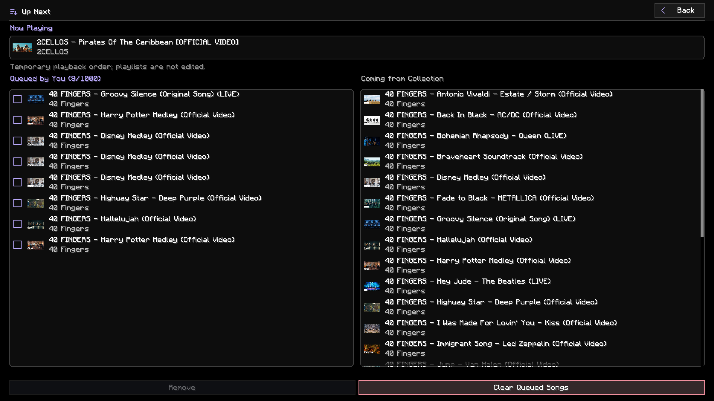
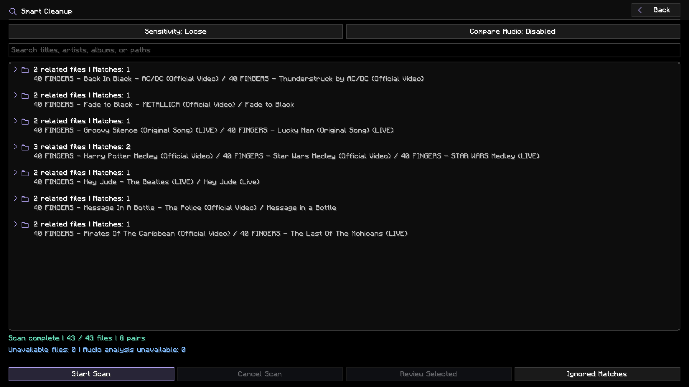
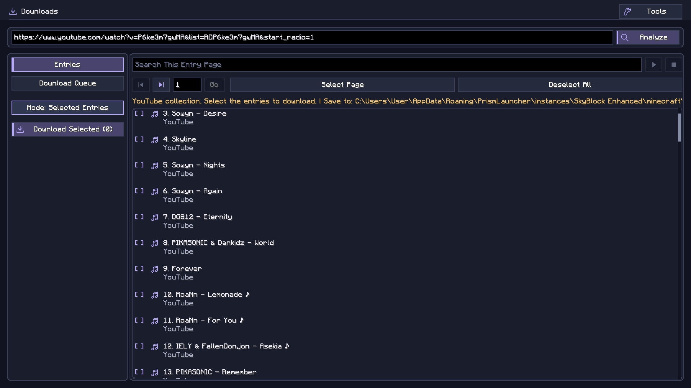
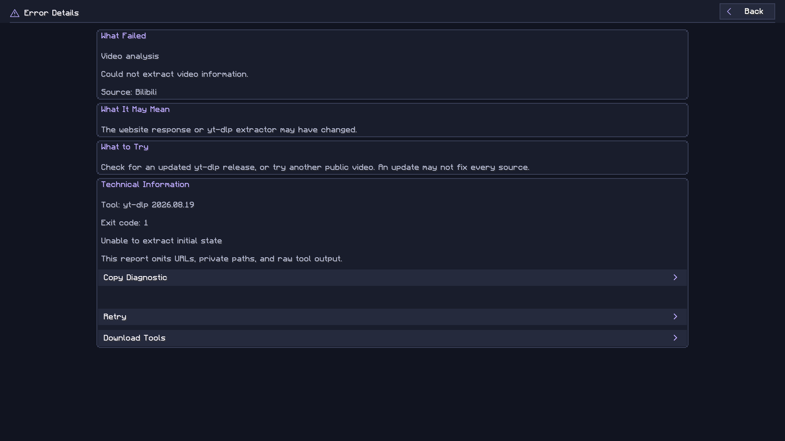
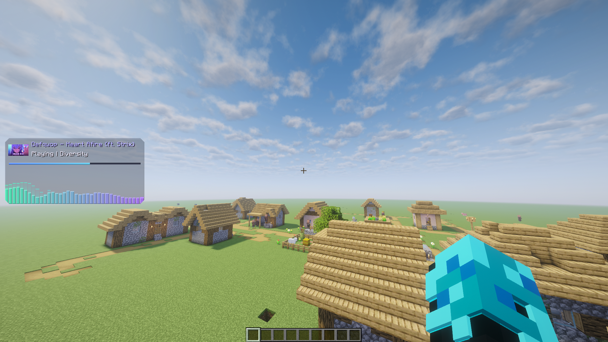
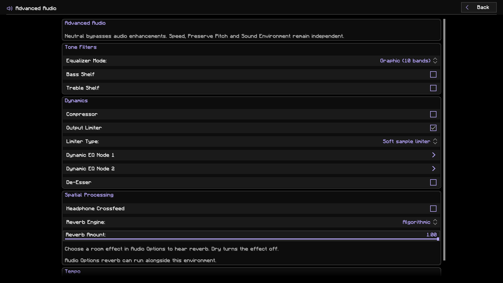
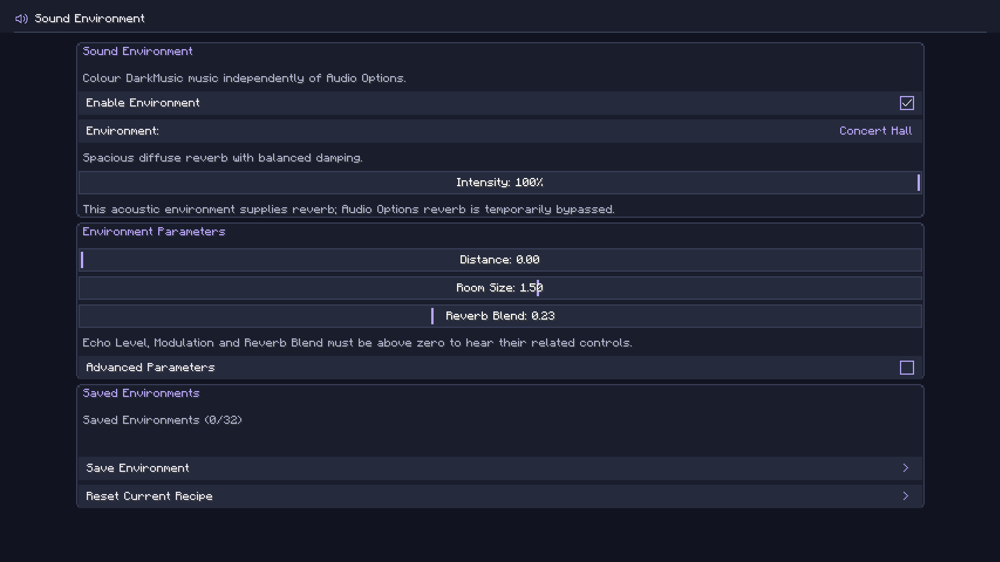
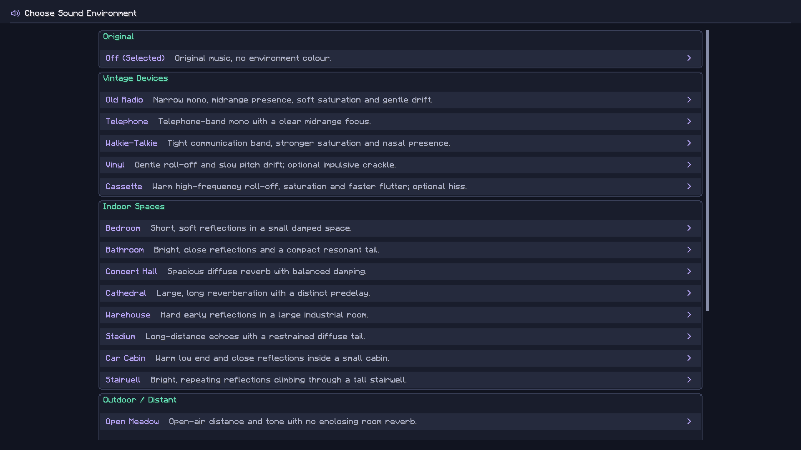
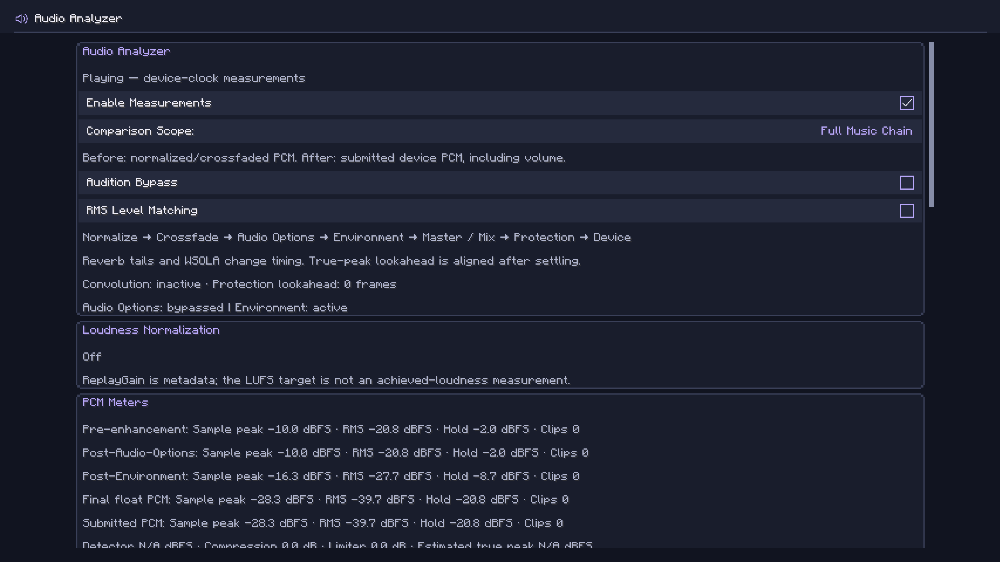
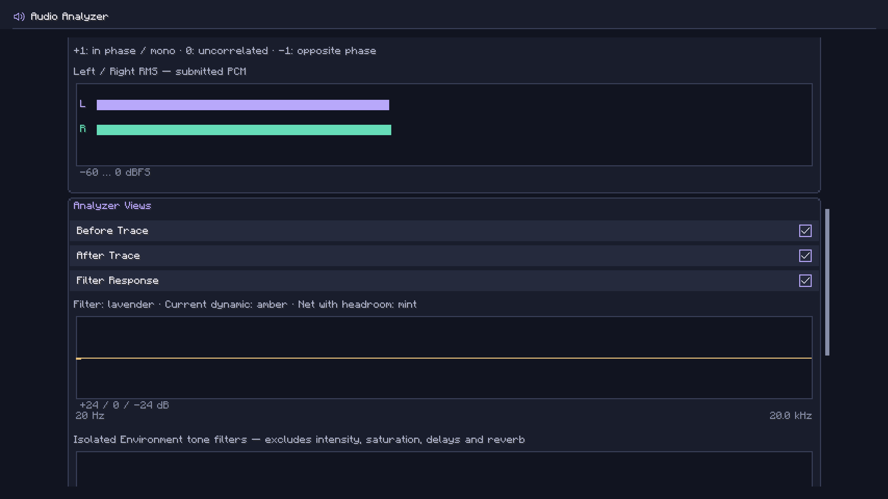

# DarkMusic User Guide

This guide describes DarkMusic v3.0.1 for Minecraft 26.2 with Fabric and Java 25.

## Picture-in-Picture (Windows x64)

PiP is inactive by default, including after upgrading. Open the PiP icon, use **Check PiP Requirements**, approve **Install PiP Dependencies**, and then confirm **Enable PiP Access**. This installs dependencies inside the instance, without a companion mod or system-wide software. No restart is needed. See [PiP installation](PIP-OPTIONAL-INSTALLATION.md). Audio spectrum access has separate consent; installing dependencies never starts capture.

On Windows 10/11 x64, use the **Picture-in-Picture** icon beside **Manage Audio Files**
in the main player, or enter **/da pip** (also **/darkmusic pip**).
Choose an open application window, then press **Start Capture**. Capture remains
off until you start it, and never starts automatically after a Minecraft restart.

Use **Edit PiP Layout** to drag the view, drag its bottom-right corner or scroll
to resize it, and use the center guides to align it. Arrow keys move it; +/−
resize it. **Crop Captured Window** lets you drag a rectangle around the video
or enter precise crop percentages. Cropping changes only the displayed region.
The view preserves that region's aspect ratio.

While capturing, **Ctrl+Alt+F8** switches to the selected application and
**Ctrl+Alt+F9** returns to Minecraft, including from exclusive fullscreen.
You can choose other function keys while capture is stopped. If a shortcut is
already reserved, choose different keys and try again. Windows can reject focus
changes; Alt+Tab remains available.

Close the menus to watch while playing. **Show PiP** hides the view while keeping
capture and shortcuts active; **Stop Capture** releases capture and both shortcuts.
Showing PiP in menus defaults to off; existing saved choices are preserved.
Opacity and showing PiP in menus are independent of the music HUD. Position,
size, crop and display preferences are saved; the selected window is not.

Keep the source window open and unminimized. It may be covered by Minecraft.
Sound continues through the source application. PiP does not replay, record,
upload, or change DarkMusic playback. Enable **PiP Audio Spectrum** while capture
is stopped to visualize the selected application's process-tree audio beside PiP.
Open **PiP Spectrum Settings** for independent style, colors, opacity, effects,
smoothing, sensitivity, band count and height. Choose above, below, left or right
of the video; use **Edit PiP Layout** to preview the combined placement. At screen
edges the spectrum stays visible by moving over the video. Music HUD settings and
its audio source remain unchanged. This option defaults off and needs Windows build 20348
or later; video capture can still work where process-audio capture is unavailable.
Other audible browser tabs can contribute when they share the captured process
tree: a selected window does not guarantee tab-isolated audio. Everything in the chosen
window is potentially visible, so crop or stop before displaying private content.

The frame limit offers **Match Monitor** and manual limits from **15 to 480 FPS**,
including the detected refresh rate. Match Monitor reads Minecraft's current
monitor when capture starts, uses 60 FPS if detection is unavailable, and caps
at 480 FPS. Stop and restart capture after changing monitors to update this limit.
Existing preferences retain their frame limit; the default remains 60 FPS.
The frame limit caps capture, without generating additional video frames. Higher
limits increase processing and memory traffic. Actual smoothness depends on the
source, Minecraft's frame rate and the display. Captures are limited to 3840×2160.
Linux/macOS capture, protected content, HDR, elevated apps and all multi-monitor
combinations are not supported or verified. On the tested system, the default
capture path delivered about 48 FPS from a 144 FPS Chrome source in both borderless
and exclusive fullscreen; selecting 144 FPS does not guarantee 144 captured frames,
because Windows limits how often it delivers new window frames. See the
[verification record](PIP-VERIFICATION.md) and [capture investigation](PIP-WGC-INVESTIGATION.md).

**Screen tearing in exclusive fullscreen.** On one tested system (144 Hz, VSync off, 140 FPS cap), visible tearing across the whole screen appeared in menus such as the inventory and the PiP layout editor while PiP was capturing, with Minecraft in **Exclusive** fullscreen and no other mods. Borderless and Windowed did not show it. PiP settings now show a warning when exclusive fullscreen is on. If you see tearing, change the fullscreen mode in Video Settings. Turning VSync on did not fix it. The cause is not fully established, and other graphics hardware has not been tested.

## Interface language

DarkMusic includes English and Traditional Chinese (Taiwan). Choose **繁體中文（台灣）** in Minecraft's **Options → Language** menu to use Traditional Chinese. Song names and other music metadata remain as supplied by your files.

## Add your music

Press **B**, open **Settings → General → Music Folders**, and choose **Add Music Folder**. A native folder picker opens. Register multiple folders to scan them and their subfolders together. The checked **Default Save Folder** receives downloads and imports without a selected folder. Selecting a save destination preserves folder order. Removing a scan folder leaves its files on disk.

The default folder is `config/darkmusic/music` inside your Minecraft instance. Copying music there also works. Library changes are discovered automatically; use Refresh Library if a change has not appeared.

Folders scan independently, so a slow or unavailable network folder does not hold back results from healthy folders. Partial or failed scans retain previously indexed songs while adding newly discovered entries; only successful scans remove missing entries. Adding or removing a scan folder preserves entries for still-registered folders. Changing only the Default Save Folder leaves the library and current scans in place.

**Open Folder** opens the root or subfolder selected in the player's All view. All Tracks, playlists, artists, and albums use the Default Save Folder instead. Hover over the button to see its destination.

**Use Built-In Save Folder** in Music Folders restores that save destination while retaining other registered scan folders. It leaves audio in its existing location. Refresh Library sits beside Import History in the player; narrow layouts place these actions in Collections.

MP3, FLAC, WAV, Ogg Vorbis, and AIFF use the bundled audio readers. Opus, AAC, MP4/M4A, and WebM playback uses FFmpeg. These formats require a compatible FFmpeg installation, available through **Downloads → Tools**. Actual playback depends on the codec in the file.

Titles, artists, albums, duration, and artwork are read from available metadata. Missing metadata may appear as a filename or an unknown artist/album. Use the player's pencil button to edit a selected song's tags.

### Drag and import

Drag one or more audio files into the music player or playlist manager. DarkMusic copies the files into the configured music folder; the originals stay where they are. Imported songs appear automatically. Existing destination files are kept, with a numbered filename used for a new copy when necessary.

The destination follows the selected collection:

| Selected view | Import destination |
|---|---|
| All Tracks | Music folder root |
| A folder in All | That folder |
| A playlist, including Favorite Music | Music folder root, with entries added to that playlist |
| Artists, Albums, or no valid collection | Music folder root |

Import feedback appears while files from a real drop are copied. File acceptance uses Minecraft's normal file-drop handling.

Open **Import History** beside Open Folder to review import times, filenames, destinations, and success or failure results.

## Browse and play


Choose **All**, **Playlists**, **Artists**, or **Albums**. The left panel shows collections and track counts. In All, folder disclosure symbols expand nested folders; folders start collapsed.

Search filters the visible list. Select a song and press Play, or double-click it. The right panel shows the selected song's details and artwork. It can show a different song from the one currently playing. Play starts that selection; Pause/Resume controls the current song only when both the song and its source collection match. The right-side spectrum follows that same rule. Track changes automatically reveal the playing song and its source collection when the search is empty and not focused. An active search keeps its text, cursor, and focus while music continues normally.

The player uses larger borderless playback and utility icons. Volume has a slim filled track and percentage readout; Speed has a matching filled track and a multiplier on its left. The player controls are centered independently of the song list. Speed and Volume sliders sit at the outer edges, with Reset Speed and Mute beside the playback buttons. All controls use equal horizontal spacing. In the three-column layout, the song list is also centered; the details panel keeps its usual width.

The centered controls are:

**Speed · Reset Speed · Shuffle · Jump to Playing · Previous · Back 5 Seconds · Play/Pause · Forward 5 Seconds · Next · Stop · Repeat · Mute/Unmute · Volume**

Drag the speed or volume marker, or focus the slider and use the arrow keys. Speed ranges from **0.5× to 3.0×** in 0.1× steps; speed changes also change pitch unless Preserve Pitch is enabled in Advanced Audio. Reset Speed returns to 1.0×. Mute/Unmute restores the last audible volume when unmuting. Supported controls show their current key bindings in hover help. Drag or click the filled progress track above the controls to seek.

Space toggles Play/Pause while the player is open. DarkMusic shortcuts also work after clicking player controls. Press Tab to navigate controls with the keyboard; arrows and Space then operate the focused control. Any mouse click leaves Tab navigation. Search keeps normal typing and blocks playback shortcuts while focused; click empty space to release it. Manual Previous and Next wrap through the playback collection regardless of repeat mode.

Repeat controls what happens when a song finishes, cycling between:

| Mode | Behavior |
|---|---|
| Off | Stop at the end of the collection |
| This | Repeat the current song |
| All | Repeat the collection |

Shuffle randomizes that same collection. Starting a song from a search still uses the full folder, playlist, artist, album, or All Tracks collection. **Jump to Playing** returns to that source collection, clears search, and reveals the song.

Long labels can be scrolled horizontally with a horizontal wheel gesture or Shift + wheel. Song rows do not display hover popups. **Show Hover Info** controls help on settings and other controls. Use Back in secondary menus or press Escape to return to the previous screen.

## Up Next

Open **Song Actions** (the More icon at the top-right of the song details panel) for the selected library song. The menu shows its artwork, title, and artist:

- **Play Next** places it before other manually queued songs. Repeated Play Next actions put the latest choice first.
- **Add to Queue** appends it after other manually queued songs, before the remaining collection.

Open **Up Next** beside Downloads in the player header; compact layouts use a playlist icon with hover help. The screen separates Now Playing, Queued by You, and Coming from Collection. Drag manually queued songs to reorder them, including connected selections. Select an occurrence and use Remove to take it out of the queue. Duplicate songs are separate occurrences. Clear Queued Songs removes pending manual entries without stopping playback.

Drag a song from Coming from Collection into Queued by You to add a queued copy at the drop position. Its artwork, title, and artist follow the pointer; the original collection entry remains. The collection preview shows up to 25 tracks. Hover either section heading for a short explanation.



The collection preview stops at an unprepared shuffled-cycle boundary rather than guessing the next order. Repeat This still shows the remaining collection separately; the screen explains that those songs and manual entries are waiting.

The queue holds up to 1,000 pending songs. It stays available when screens close or worlds change, but resets when Minecraft exits. It is not a playlist, is not saved in backups, and never edits your playlists. Directly playing a new library selection starts a new session and clears pending entries. Stop, restarting the current selection after Stop, and Play/Pause keep them.

Manual songs temporarily interrupt the original collection, which resumes at its next position afterward. Shuffle affects only the collection. Repeat All repeats the collection, not the manual queue. Repeat This holds queued songs while the current song repeats; Next still advances to a queued song. Previous revisits played songs without putting consumed entries back in the pending queue.

Jump to Playing locates a manually queued song in its library folder when it is outside the original collection. This does not replace the collection used for subsequent playback. Successful deletion removes matching pending entries; failed or canceled deletion retains them. Metadata edits preserve queue positions. Unregistering a folder removes its pending entries, while incomplete scans retain them.

## Listening history

Use the history-clock icon immediately left of Manage Playlists above the collection list. Choose Recently Played or Most Played to browse play counts, listening time, and last-played dates.

Listening time follows audible playback rather than elapsed screen time. Pausing, seeking, and muting do not add listening time. A play counts after 30 seconds or half of a shorter song. Playback started from History keeps both history lists in their current order until you start playback from another collection. Statistics continue recording during that time.

Use **Settings → General → Clear Listening History** to clear these statistics. Audio files and playlists are kept.

## Backup and restore

Open **Settings → General → Backup / Restore**. Export Backup saves a ZIP containing settings, audio/environment profiles, playlists, DarkMusic key bindings, and listening history. It contains no music files, download tools, or artwork assets. Export preparation and ZIP writing run in the background.

Open Backup shows a restore preview. Select the categories to restore and choose whether to merge or replace playlists and history. Selected settings and key bindings replace their current values. Song references can be remapped to the current music folder using relative file paths. Unmatched references are retained for later matching.

Restore asks for confirmation and creates recovery copies of affected data. The current music folder path, tool paths, and audio output selection remain local to the installation. Copy your audio files separately when moving a library to another computer. If a restore is interrupted, DarkMusic recovers the previous setup on the next launch before loading it. If recovery is blocked by storage or permission problems, fix the reported problem and restart; recovery copies are retained.

## Audio output

Open **Settings → Audio → Audio Options → Output Device** to select an available Java Sound output device. System Default uses the operating system's default playback route. Refresh the list after connecting a device.

Switching preserves playback position and pause state when the destination supports the audio format. A rejected switch keeps the previous route. An unavailable saved device can fall back to System Default. Device names and hot-plug behavior depend on the operating system; Bluetooth and Linux/macOS behavior have not been manually verified for this release.

## Manage playlists


Open **Manage Playlists** with the music-note button above the collection list. Playlist creation, rename, and delete actions sit above the left list; Add Songs and Remove Selected sit above the song list. Selection actions are below the songs. Create or rename a playlist, and use **Add Songs** to choose tracks. Songs already in the playlist are omitted from the picker.

Use selection controls or Ctrl/Cmd-click to select individual songs. Shift-click extends a selection. Ctrl/Cmd+A selects the list. Connected selections can be dragged together to change their order.

Remove Selected removes playlist entries; removing multiple entries asks for confirmation. Deleting a playlist also opens a confirmation dialog. Neither action deletes your audio files. Successfully completed folder scans remove confirmed missing tracks from playlists and Favorite Music. Offline or inaccessible folders and incomplete root scans do not trigger cleanup for those folders.

Play playlists from the main player's Playlists view.

### Favorite Music

Click the heart in the selected song's right-hand panel to add or remove it from **Favorite Music**. A filled heart marks a favorite; liking a song briefly animates the button. Favorite songs also show a small filled heart before their artwork in the track list.

Favorite Music is a built-in playlist with a heart icon in both playlist views. It supports adding, importing, reordering, and removing songs. Its name and playlist cannot be deleted or renamed.

### Edit song details

Select a song and click the pencil in its details panel to edit the title, artist, album, or filename. The filename field contains only the name; the file extension is kept automatically. Saving writes the metadata to the audio file and updates the library and playlist references.

If that song is playing, saving briefly releases its playback handle and resumes at the previous position and playing/paused state. Renaming also keeps matching lyric sidecars with the song. Unsupported tag formats or failed writes show an error. Opus and WebM tagging requires FFmpeg. Back up important files before deliberately editing their tags.

The details actions are Heart, Pencil, Lyrics (when enabled), Open Source, and Copy Source Link. Source actions are available when DarkMusic knows the original video URL. Copy Source Link displays **Copied!** after successful copying. In narrow panels the confirmation appears as a brief tooltip. Downloads record source associations, which follow imported or renamed files. The actions are hidden when the panel has no selected song.

### Delete audio files

Open **Manage Audio Files** with the wrench above the player's collection list, or from **Settings → General → Music Folders**. Search the library, select one or more files, and choose **Review Selected Files**. The review shows full file paths before deletion. The song-details editor also offers **Delete Audio File…** for a single file.

Use **Move to Trash** when the operating system supports it. **Delete Permanently…** requires a separate confirmation and cannot be undone through DarkMusic. A failed Trash operation never switches to permanent deletion automatically.

Only reviewed audio files are removed by default. You may explicitly include associated lyric sidecars, provenance, and backups in the review; those companions always use Trash, even when audio deletion is permanent. Lyrics shared by another audio format with the same filename stem are kept. Renaming one format copies shared lyric companions so the other format keeps its lyrics and attribution. A failed Trash operation never becomes permanent deletion. Successfully deleted tracks are removed from playlists, Favorite Music, and Up Next; failures remain available to review and retry. File changes detected after review require a fresh review.

During deletion, **Cancel Remaining Files** stops pending work. An already-issued Trash operation finishes or reaches its timeout before its outcome is reported. Completed deletions remain completed, and untouched pending files are listed as canceled rather than failed. To delete canceled files later, select and review them again in Manage Audio Files.

Deletion briefly releases playback handles. A surviving current song resumes at its previous position and playing/paused state; deleting the current song leaves playback stopped. File operations run in the background. On Windows, Trash operations preserve fullscreen, and F11 remains available to change window mode.

## Smart Cleanup

Open **Manage Audio Files → Smart Cleanup**. Choose **Strict**, **Balanced** (default), or **Loose**, then **Start Scan**. Search filters the results. Scanning runs in the background; **Cancel Scan** stops pending analysis and keeps available results.



Related files appear in expandable groups. Open a group, select an individual match, and choose **Review Selected** or double-click it. Five fully matching files produce ten unique pairs inside one group. Each row retains its own evidence: a match between A and B and another between B and C do not imply that A matches C.

Evidence may include exact file contents, the same source video, similar titles or filenames with supporting metadata/duration, similar audio fingerprints, or possible audio overlap. These are review suggestions. Loose includes weaker similarities and can match different songs with similar production; neither a label nor grouping proves that files are interchangeable. Live, remix, cover, and other version differences are highlighted where identifiable.

**Compare Audio** uses existing FFmpeg tools for an offline spectral fingerprint of up to the first three minutes. It can find recordings with different tags, names, formats, or bitrates and some trimmed versions. It is optional and off by default; enable it to use acoustic evidence, including cached fingerprints. No online fingerprint lookup or additional executable download is performed. Very short overlap, edits beyond the analyzed excerpt, and pitch/tempo changes may be missed. This is DarkMusic's own spectral signature, not Chromaprint or AcoustID.

The comparison shows artwork, song information, full paths, file sizes, duration, format, and available codec/source details. **Play A / Play B** starts that preview; the button changes to **Pause A / Pause B**, then resumes from the paused position. Choosing the other file switches the preview. Your normal playback is paused while auditioning and restored when leaving, with its original source and Up Next preserved. Preview playback does not add listening-history plays.

- **Keep Both** dismisses that pair for the current scan.
- **Ignore Match** suppresses that pair across launches while those file identities remain unchanged. Open **Ignored Matches** to restore one or all decisions.
- **Delete A… / Delete B…** opens the existing exact-path deletion review for that file. Trash and permanent deletion retain their separate safety rules. No file is selected for deletion automatically, and there is no group-wide delete action.

Successful deletions remove affected result pairs immediately and use the normal playlist, Favorite Music, and Up Next reconciliation. Failed or canceled deletions retain the files and matches. Sidecars and artwork files are kept. After metadata edits or external file changes, start a new scan to refresh evidence; cached analysis is reused only for unchanged files. Unavailable files are counted and skipped without aborting the scan.

Analysis and ignored decisions are stored locally. Candidate retrieval is bounded for large libraries, with up to 100,000 tracks and 20,000 result pairs. A limit warning means some candidates were omitted; no sensitivity guarantees finding every duplicate.

## Download music

Open **Downloads** from the player. Wide windows use a source bar, a left navigation/selection panel, and a right preview or queue panel. Compact windows retain accessible stacked controls.



### Set up tools

Open **Tools → Install / Update Tools**. Managed setup downloads compatible yt-dlp, FFmpeg/FFprobe, and Deno executables. Updates are requested from this menu. Allow up to 1 GB of temporary space.

Under **Advanced Paths**, select existing executables if preferred. Blank paths use managed tools or system lookup. Check Tools reports whether the selected tools can run. External tool publishers and source links are listed in the tools menu.

Managed installation supports Windows x64, Linux x64/ARM64, and macOS x64/ARM64. Windows ARM64 requires compatible externally installed tools. Internet access and website changes can affect downloads.

### Analyze and select

1. Paste a video or collection URL.
2. Choose **Analyze**.
3. Choose This Video Only, Selected Entries, Entry Range, or All Entries, as available.
4. Review the selection, then download.

YouTube videos/playlists/Mixes, Bilibili videos and supported collections, and other yt-dlp-supported sources can be analyzed. A source may expose only some collection types or entries.

Preview pages contain up to 100 entries. Use Previous/Next, or enter a page number and press **Go** or Enter. Direct page selection is restricted to available pages. For collections with an unknown end, first reach later pages with Next; direct jumps can return to pages already reached.

Search filters the current entry page by title or entry number. Select Page checks visible results. Selections persist across pages. Entry Range downloads its inclusive range, such as 10–30; checked entries are used only in Selected Entries mode. Batches are limited to 1,000 entries. Unknown-ended collections require a finite range.

Select an available entry and use the preview Play button to hear up to 30 seconds. The same button pauses or resumes the excerpt; a separate Stop button ends it. Preview needs a network request and may take a moment. It stops when leaving the menu. The URL and analyzed preview remain available when returning.

### Queue and files

Downloads run in the background, including when the menu is closed. Up to three jobs run in parallel; conversion and source restrictions can limit throughput. A HUD indicator reports background progress.

Queue search covers titles, status, errors, and destination folders. **Retry Selected** retries one failed job; **Retry Failed** retries all failed jobs. Automatic retries for temporary failures, including HTTP 503 Service Unavailable, run after pending work, up to three retries per job. Clear Finished keeps failed jobs; Clear Failed removes their queue records. Cancellation stops active/queued work; completed files remain.

Completed files go into the currently configured music folder and appear in the library. **Audio Options → Download Audio Format** chooses Original / Best Available or Convert to MP3. Available title, uploader/artist, album, track number, and artwork are embedded where supported. Duplicate tracking reduces repeat downloads.

### Music already in your library

Analysis entries show **Already Downloaded**, **Possible Duplicate**, or **Not Detected**. Known source identities are indexed across all registered folders, using recorded download/source associations and available embedded source metadata. Inspect an entry's existing-copy information with the folder button beside the preview controls. An incomplete library check is shown explicitly; Not Detected is not proof that a recording is new.

When preparing downloads finds confirmed source matches, a review lists the existing titles, formats, and locations. **Skip Already Downloaded** skips only copies matching the requested output format and rechecks the files first. **Download Anyway** permits another copy or format in the chosen destination. Back cancels that pending choice without starting it. Skipped jobs are reported as skipped, not newly saved.

The existing destination-specific download history remains active. Renaming files through DarkMusic updates provenance; external renames or moves that lose source associations may not be recognized until metadata or a new scan supplies them. Offline or missing files are never silently treated as verified copies. Canonical YouTube/Bilibili URL forms and recorded extractor/media IDs provide source identity; support for other URL aliases depends on the recorded information.

**Possible Duplicate** uses available Smart Cleanup evidence. It never silently skips a download and does not run acoustic analysis in the download pipeline. Different uploads of the same recording can still require Smart Cleanup review after downloading. The local index and retained evidence refresh as the library changes; no extra website requests are made for these checks.

Restricted, deleted, private, or unsupported content may fail. DarkMusic does not bypass authentication or DRM. Download only material you are authorized to save.

### Error details and safe reports

When analysis fails, use the warning-icon **Error Details** action beside search. The entered URL remains available for another attempt. In Queue, select a failed job and use Error Details for that attempt. Clearing finished jobs keeps failed jobs; Clear Failed removes their diagnostics too. A successful retry clears the current failure presentation.

The report identifies the stage (analysis, download, conversion, validation, or local saving), the tool, and a recognized error category. “What it may mean” is an interpretation, not a proven root cause. For example, HTTP 403 establishes that access was refused; it does not establish why. A Bilibili “Unable to extract initial state” error can indicate a changed website response or extractor, rather than a disconnected network.

**Copy Diagnostic** copies the DarkMusic version, available relevant tool version, source category, stage, diagnostic category, operation/attempt ID, exit code, a short recognized error phrase, and suggested action. Full URLs, video identifiers, local paths, credentials, and arbitrary raw output are excluded. Unrecognized technical output is omitted. Copying does not upload anything.



Use Retry when appropriate, or the existing queue retry controls. Automatic retries keep their existing limits; extractor and authentication failures do not repeatedly retry automatically. Wait before retrying rate-limited requests. Cancellation remains separate from failure.

Tool-related reports link to **Download Tools**. Check Tools validates the chosen executables; Install / Update Tools retrieves managed releases only after your action. Advanced Paths may select executables instead of the managed ones. Updating tools may help with website changes, but does not guarantee that a source will work. A website can break a yt-dlp extractor without a DarkMusic change; not every website failure can be identified reliably. DarkMusic does not bypass authentication or DRM.

## Mod updates

**Settings → General → Update Notifications** checks GitHub when joining a world or server and notifies once per launch. Turning it off disables automatic checks and notices. **Check for Updates** checks manually regardless of that toggle and reports availability or errors. An available update requires a separate **Download Update** click; nothing downloads simply because a check found it.

A completed download is announced in client-side chat. Close Minecraft and wait a few seconds before restarting so the update can install. Settings, music, playlists, artwork, other assets, and other mods are preserved. New options receive their defaults. Updates require a compatible official release with a verified checksum; development source-set launches can check for releases but cannot install updates. If an installation fails, the existing version remains active. A client-side notice appears once per launch when notifications are enabled, and Check for Updates offers Open Installation Log even when notifications are off.

## Customize the HUD


Settings contains General, Audio, HUD, Spectrum, and Reset sections. Most changes save immediately. The preview shows current playback data, or sample visualization when no song is playing.

**Now-Playing HUD** enables the whole in-game component:

- **Classic:** song information with optional artwork, progress, and spectrum.
- **Circular:** the DarkMusic icon, optional circular progress, outward spectrum, and optional title/artist text. Disabling progress removes the ring rail and anchors the spectrum directly to the icon.
- **Spectrum Only:** the audio-reactive spectrum without artwork, track text, progress, or a background. It uses the same spectrum colors, effects, direction, height, and layout editor.
- **Artwork:** larger, aspect-preserving artwork and spectrum. An optional progress bar touches the bottom of the image. Position the spectrum above, below, left, or right; side spectra grow horizontally away from the image. Audio-Reactive Artwork optionally pulses the image with the music without stretching it. The whole layout moves and scales as one HUD.

Choose a spectrum style, bar count, sensitivity, smoothing, and height in every layout. Above/below spectra support upward or downward growth. HUD contains background transparency, progress appearance, and other layout options. Spectrum contains its style, direction, finish, effects, colors, and sliders. Classic and Artwork share solid/gradient background controls; background transparency does not fade the artwork or other foreground content. Frequency smoothing, peak hold, trails, and glow have individual switches in Spectrum.

Color editors offer **Color Spectrum** or **RGB** mode, one at a time. In Color Spectrum, choose a hue on the rainbow strip and saturation/brightness in the field above it. Palette colors, **#RRGGBB** input, and **Default** remain available. Settings → Appearance contains the menu background and accent colors. Gradient presets are paged so all choices remain reachable.

New installations and Reset to Defaults use 100% HUD background transparency, all four spectrum effects enabled, Beveled spectrum/progress finishes, and Ocean Drive colors. Lyrics start disabled. Existing saved choices are retained when upgrading.

For Circular HUD, **Audio-Reactive Icon** selects **Off**, **Audio Level**, or **Beat**. Audio Level follows the music's energy; Beat pulses on detected onsets. Settings sliders use a vertical handle without a filled horizontal track.



The spectrum analyzes decoded music samples. Pause freezes it; seeking, stopping, and track changes reset its analysis state.

Scroll over the settings preview to resize that preview. Its scale is independent of the saved in-game HUD scale.

Use **Edit HUD Layout** beneath the preview, or `/da gui`, to position the actual HUD. Drag it to move; scroll over it to change its scale in 10% steps from 50% to 300%. A scale indication appears while resizing. Escape saves and returns. The HUD and its spectrum move as one component. Horizontal and vertical center guides brighten when aligned. Drag near the center to snap; hold Shift for free placement without snapping.

## Audio options


**Original / Neutral** bypasses Audio Options coloration. Turn it off to adjust normalization, equalizer, bass, stereo width, compression, reverb, or limiting. Sound Environment remains independent. Volume, speed, Preserve Pitch, and listening mode have their own controls. Preserve Pitch also works with Neutral enabled.

Profiles provide presets, plus named saved configurations. A trash button beside each saved profile opens a deletion confirmation. Deleting a saved profile leaves the current sound settings active; built-in profiles remain available. The 10-band equalizer supports presets and individual adjustments. Loudness normalization uses available tags; Analyze Untagged Loudness can measure missing loudness information with FFmpeg. Album mode uses album loudness tags when available. Cached loudness data applies from the first audible sample. If loudness data is unavailable when playback starts, that session keeps a stable gain while information is cached in the background for the next session. Seeking, changing audio output, and continuing after metadata edits keep the same decision. Background analysis prioritizes the upcoming track without waiting to start playback. If its measurement is ready in time, normalization applies from its first audible sample.

Gapless playback preloads consecutive songs. Crossfade sets overlap duration. Listening Mode offers Normal, Focus (quieter game sounds), and Ambient (quieter music). Duck on Priority Sounds briefly reduces music for important game sounds, with level and timing controls.

### Advanced audio

Open **Advanced Audio** from Audio Options for graphic/parametric EQ selection, five parametric nodes, bass/treble shelves, two dynamic EQ bands, a de-esser, headphone crossfeed, compressor parameters, and pitch-preserving tempo. Controls start disabled where appropriate, so existing profiles retain their saved choices.

The limiter offers the existing soft protection and optional **True Peak** protection. True Peak uses an 8× intersample detector, a −1 dBTP target, and 64 frames of lookahead. Its latency is reported in the analyzer. Pitch-preserving tempo changes speed while retaining pitch; ordinary speed playback remains available.

Reverb supports the existing algorithmic rooms or partitioned convolution with three original modeled impulse responses: Short Room, Hall, and Dark Cave. These are generated room models, not recordings of physical venues. Impulses prepare in the background, with algorithmic reverb while preparation is pending or fails. Convolution supports device rates from 8–192 kHz; the analyzer reports preparation, readiness, or fallback.

Normalization reports whether gain comes from track/album tags or analysis, whether analysis is pending, and whether a measurement is unavailable or failed. Album mode reports track fallback only when valid track metadata or file analysis is actually used. Music and Night profiles enable analysis for untagged tracks when newly selected; previously saved preferences remain unchanged.

Frequency sliders use logarithmic spacing for finer low-frequency control. Right-click a numeric slider, or focus it and press Enter, to type an exact value. Enter applies a valid value; Escape cancels.



**Parallel Loudness Analysis** under Audio Options → Loudness is off by default. Enable it for up to three simultaneous jobs, depending on CPU capacity; higher CPU use may reduce game performance. **Analyze Library Loudness** prepares measurements for the scanned library and shows progress. **Stop Library Analysis** cancels that batch and retains completed measurements. Cached measurements are reused, and newly measured gains apply on the next playback session.

### Sound Environment

Open **Settings → Audio → Sound Environment** independently of Audio Options. Choose Off or one of 22 active environments: Old Radio, Telephone, Walkie-Talkie, Vinyl, Cassette, Bedroom, Bathroom, Concert Hall, Cathedral, Deep Cave, Tunnel, Warehouse, Stadium, Open Meadow, Forest Clearing, Next Room, Distant Speakers, Underwater, Dreamscape, Car Cabin, Stairwell, and Orbital Echo.

Select Environment to open a categorized list, then choose a treatment directly. The list stays open for comparing environments; press Escape to return to its controls. Car Cabin gives warm low end and close reflections, Stairwell adds bright repeating reflections, and Orbital Echo creates spacious stereo echoes with slow modulation.

Enable the environment and adjust intensity. At 0%, the environment is bypassed. Relevant tone, reflection, distance, and room controls depend on the selected recipe. Texture and ambience are optional. Enable **Advanced Parameters** to reveal additional controls directly below that toggle. Save, load, rename, or delete custom environment presets without altering Audio Options profiles.

Acoustic environments take ownership of the shared reverb slot while active. Audio Options reverb is restored when the environment is switched off. Non-acoustic treatments such as Vinyl allow Audio Options reverb to continue.

Save up to 32 environments with names of up to 80 characters. A matching name opens Replace / Cancel confirmation.





### Audio Analyzer

Open **Audio Options → Audio Analyzer**. Choose Audio Options, Environment, or Full Chain comparison. Measurements follow the PCM actually submitted to the audio device and include stage RMS/peak, stereo correlation, dynamics reduction, measured spectra, waveforms, and applicable filter-response curves. Response curves describe filters; they do not claim to represent nonlinear processing, modulation, or reverb.





Spectrum, waveform, and response panels can be switched off independently. Measurements freeze on pause and clear on seek/stop. A/B bypass and optional level matching are temporary and are cleared when leaving the analyzer; they do not overwrite profiles. Normalization, tempo, master/listening gain, and output protection remain active during coloration comparisons.

## Lyrics

Open **Settings → Lyrics** and turn on **Enable Lyrics**. Open the selected song’s Lyrics icon beside Pencil and Open Source to read lyrics, search for a match, choose a version, or adjust its timing.

### Automatic and manual lookup

**Advanced Lyrics** contains Online Lyrics Lookup, Automatic Lookup on Playback, Find Missing Lyrics, and Look Up Lyrics After Downloads. Online access starts off and requires a one-time consent prompt, including for upgraded installations. The master Enable Lyrics setting retains your existing preference and starts off on new installations. Playback and post-download lookup preferences are preserved, but cannot access the network until online lookup is approved.

Online lookup sends the song’s title, artist, album, and duration to LRCLIB. Audio files are not uploaded. Turning off Online Lyrics Lookup keeps local and previously saved lyrics usable.

Choose **Find Missing Lyrics → Start** to check the collection explicitly. DarkMusic shows the checked count, actual LRCLIB request count, and waiting status. It checks songs one at a time without selecting or playing them, waits for library scanning and media operations, skips unhealthy roots, and keeps its place across rescans. Cancel stops owned pending requests. Closing the screen does not cancel the run. Playing or deliberately selected songs can also request lyrics when enabled. New-download lookup begins after the audio is saved and does not delay the download worker.

The first reliable version is saved locally and applied automatically, with alternate versions retained for review. Library cancellation also cancels owned caption fallback and retries; unrelated manual searches remain active. Weak matches are not applied automatically. Existing local sidecars, embedded lyrics, and explicitly chosen versions take priority. A match is based on metadata and duration; different recordings can still need manual correction.

Results are cached across launches. Confirmed empty provider responses are cached for 14 days; temporary failures are not saved as missing lyrics. Network and temporary provider failures retry per song without keeping it selected, with increasing delays of up to 30 minutes; this does not pause later library songs. Provider-wide waits apply to actual rate-limit responses or explicit Retry-After values, bounded to 24 hours. Requests are normally spaced at least one second apart. A 503 without Retry-After does not invent a global rate-limit wait. The status shows the retry countdown; horizontally scrolling it keeps your reading position as the countdown changes.

In **Search Lyrics**, edit the search title or artist without changing your music tags. Preview a result and choose **Apply**. Manual search results require Apply even when the search was retried automatically. **Refresh Lyrics** refreshes the LRCLIB search; **Find Source Captions** separately checks the known original video. Neither requires downloading the audio again. Source captions need working download tools and a recorded source link.

Automatic lookup uses LRCLIB first, then source captions when no reliable match is found or the provider fails. Automatic caption requests use DarkMusic-recorded provenance for known YouTube/Bilibili hosts, not arbitrary URLs in audio tags. Legacy filename-only provenance requires manual review rather than automatic source identity decisions. Manual captions are preferred. **Allow Autogenerated Captions** is off by default; enabling it permits source-generated captions and labels them as generated. Captions may contain dialogue, and neither provider coverage nor website caption availability is guaranteed.

### Language and versions

Lyrics do not follow Minecraft’s UI language or the operating-system locale. Auto uses a credible file language tag to resolve caption ties where possible; otherwise it prefers original captions only when one eligible track is unambiguous. Set ordered language preferences, including regional tags such as `ja`, `zh-Hant`, or `en`, when multiple caption languages need a choice. An explicit per-song language setting is available in Lyrics Options. Unknown or shared-script text is not treated as a verified spoken language.

Available original, translated, transliterated, or generated variants retain their source information when known. DarkMusic does not translate lyrics or transcribe audio itself. Plain lyrics are shown as **Unsynchronized Lyrics** in a scrollable view; timestamps are never invented.

### Local files and synchronization

Place `Song.lrc` beside `Song.mp3` (or another supported audio file), or use **Import Lyrics** in the song’s Lyrics Options. Supported embedded tags remain available. Standard LRC lines look like this:

```text
[00:12.30]First line
[00:16.80]Second line
```

Lyrics Options provides a per-song offset from −30,000 to +30,000 ms. Positive values display lyrics later. Adjust in 100 ms steps or enter an exact value through the slider’s numeric editor, and reset to original timing when needed. The offset is saved separately rather than rewriting timestamps.

Online results and selections are stored under `config/darkmusic/lyrics` by default. **Save Lyrics** writes the selected content beside the audio. **Replace Existing Lyrics** captures the displayed version, requires confirmation, and preserves the first backup across repeated replacements; **Restore Previous Lyrics** is available when that backup exists. **Keep Existing Lyrics** clears the chosen online version. Cache clearing leaves saved per-song selections and music files intact. Imports accept text/LRC files with confirmation and reject binary content. Auto encoding supports Unicode; select Big5, GB18030, Windows-31J, or EUC-KR explicitly for older lyric files. External audio retagging preserves timing/language preferences and offers the previous lyric selection for confirmation. Orphaned saved records are pruned only when the associated roots can be checked safely.

Checkmarks indicate available lyrics, question marks indicate an unchecked or unresolved state, and crosses indicate a completed miss or a failed lookup. Read the status text: **Local check finished** only covers files on your device; online availability is still unknown. **Lookup finished — no lyrics found in checked sources** is the final empty result for that lookup, not proof that lyrics do not exist elsewhere. **Lookup incomplete** means an error prevented a conclusion; **Lookup paused** is waiting to retry. **Lyrics found — choose a matching version** needs your review. A caption-only check says so explicitly. A plain result is available even though it cannot drive synchronized HUD lines.

### Lyrics HUD

Lyrics are an independently movable element in every HUD layout. Enable **Lyrics in HUD**, choose **Lyrics HUD** to adjust width, colors, opacity, and the next line, then select the lyrics element in **Edit HUD Layout** to move or resize it separately from the player.

The live HUD stays empty before the first timestamp and when synchronized lyrics are unavailable. It shows no missing-lyrics message. Layout editing can show a preview so the element remains easy to position. Timing follows the current playback position through pause, seek, speed changes, and track transitions.

## Reading status messages

Changing statuses use consistent colors throughout the menus: **blue** for activity and information, **green** for available or successful results, **amber** for warnings, uncertainty, and review, and **red** for failures. The text explains the outcome; color is an additional cue.

In download rows, status appears first in color, followed by neutral file information such as the saved filename, format, and location. A saved download with a bookkeeping warning stays amber rather than looking like an unqualified success. Smart Cleanup evidence and lyrics results retain their explicit strength or availability labels. Status colors adapt for contrast when you change the menu background.

## Shortcuts and commands

| Action | Default key |
|---|---|
| Open player | B |
| Play / pause | Backslash |
| Previous / next track | [ / ] |
| Volume down / up | Down / Up arrow |
| Speed down / up | − / + (minus / equals key) |
| Back / forward five seconds | Left / Right arrow |
| Stop | P |
| Jump to Playing | O |
| Reset speed | Numpad 0 |
| Mute / unmute | M |

Volume changes in 5% steps and speed in 0.1× steps. Volume, mute, and speed shortcuts briefly show a HUD notification. Rebind controls in Minecraft's Key Binds menu under DarkMusic.

| Command | Action |
|---|---|
| `/da` or `/darkmusic` | Open player |
| `/da gui` or `/darkmusic gui` | Edit HUD layout |
| `/da lyrics` or `/darkmusic lyrics` | Open lyrics for the current song, including while paused |
| `/da update` or `/darkmusic update` | Check for updates and download an available update |
| `/da help` or `/darkmusic help` | Show grouped commands, shortcut guidance, and links |

The lyrics command leaves playback and the temporary queue unchanged. Lyrics must be enabled in Settings; online lookup is optional. If nothing is playing, the client is busy, or lyrics are disabled, a local message explains why the menu cannot open. A paused song is still eligible. The song is rechecked after chat closes, and pending menu requests are canceled when the world changes. Click a command in `/da help` to put it into chat before running it.

These commands are handled client-side; help feedback is shown locally.

## Saved data and reset

Settings, playlists, and import history are stored in the instance's `config/darkmusic` directory. Your configured music folder can be elsewhere. Keep that configuration directory with your library when backing up playlists and preferences.

**Reset to Defaults** opens a confirmation dialog. It restores settings, key binds, HUD layout/scale, volume, speed, and the default music folder path. It stops work and clears recognized download history, import history, and caches. Your audio/video files, playlists, installed download tools, and configured executable paths are kept. Clearing download history allows the same sources to be downloaded again.

## Troubleshooting

| Problem | What to check |
|---|---|
| Empty library | Confirm the folder in Settings and the audio file format; use Refresh Library |
| Opus/M4A/WebM will not play | Install or select working FFmpeg/FFprobe in Download Tools |
| Artwork missing | Check whether the file contains supported embedded artwork |
| Lyrics missing | Check Enable Lyrics, timed data, matching `.lrc` basename, and source caption availability |
| HTTP 403 or 429 | Check public access, update tools, or wait before retrying |
| HUD missing | Enable Now-Playing HUD and start music; check HUD layout |
| Audio Options effects unavailable | Turn Original / Neutral off; Sound Environment has its own master switch |
| Shortcut conflict | Rebind it in Minecraft's Key Binds menu |
| Screen tearing while PiP is capturing | Set Minecraft's fullscreen mode to Borderless or Windowed instead of Exclusive. See the note under Picture-in-Picture |

For a reproducible issue, share the mod/Minecraft versions, operating system, steps, and relevant logs in [GitHub Issues](https://github.com/DarkLian/DarkMusic/issues). Remove private details before posting.

## License and modpacks

DarkMusic remains free of charge. From v2.8.2, new original DarkLian contributions use the [DarkMusic License & Permissions](../LICENSE), allowing private modifications and inclusion of unmodified official binaries in modpacks with attribution, preserved notices, and third-party license compliance. Other redistribution or distributed modifications containing that new protected material require written permission. Previously released CC0 portions and separately licensed components retain their existing rights; the change is not retroactive.


### Interrupted backup recovery

Recovery checks stored hashes before restoring configuration, playlists, history, or shortcuts. If a file has newer or unrecognized contents, DarkMusic preserves it and keeps recovery copies under `config/darkmusic/backups/<transaction>/conflicts`. Startup reports the conflict instead of overwriting that file. Keep the pending journal and recovery directory until you resolve the conflict; old journals without replacement hashes may require manual review.

Source-association write failures leave the audio saved and show a partial-success warning. DarkMusic retains a file-bound receipt and retries bookkeeping independently of downloading audio, up to three times (after 10 seconds, then at 60-second intervals). If storage remains unavailable, the receipt stays for a later download attempt. Moving or replacing the file can prevent automatic repair; unrelated replacement contents are not associated with the old source.

### Waveform progress bars

In **Settings → HUD → Progress Bar**, enable **Waveform Progress Bar** to show the actual song envelope in the main player's seek bar and the Classic, Artwork, and Circular HUD progress displays. The played portion uses your progress colors. HUD progress visibility, waveform mode, finish, and colors are grouped together. The waveform toggle also works when the HUD is disabled; Spectrum Only retains its progress-free HUD.

Choose **Filled Wave** for a smooth continuous contour or **Rounded Bars** for separated columns. Adjust height, detail, smoothing, contrast, opacity, bar spacing, and the unplayed color. Played areas keep the shared progress color/gradient and finish. Circular HUDs use height as ring thickness. The appearance controls expand below the waveform toggle and affect both the main player and HUD. **Reset Waveform Appearance** restores these controls without changing progress colors or turning waveform mode off.

The waveform blends musical energy with a small peak contribution, preserving dynamics instead of flattening loud recordings into an almost solid band. Smoothing and contrast change only its appearance. HUD background transparency, gradient, and colors remain with HUD appearance above the Progress Bar category.

The default is off. One background worker analyzes only the active song (or the HUD preview song), without changing playback, volume, speed, seeking, or audio effects. A normal progress bar appears while data loads or if analysis is unavailable. Waveforms are cached locally across launches and rebuilt when the indexed file size or modification time changes. Memory holds up to 16 envelopes; the disk cache holds up to 256 entries. Analysis is bounded to 90 seconds of work and files up to six hours, with normal-bar fallback beyond those limits.

### HUD images and circular spacing

Classic, Circular, and Artwork + Spectrum each offer **HUD Image → Song Artwork / DarkMusic Icon**. Artwork is the default in all three layouts; missing or loading artwork falls back to the same DarkMusic icon. Each layout remembers its own choice. Classic retains its separate Show HUD Image visibility toggle. Circular artwork is center-cropped to a circle without stretching.

Circular HUDs offer **Image-to-Ring Gap** from 0 to 24 GUI pixels. Zero connects the image outline to the nearest enabled layer. With both layers on, progress is closest to the image and spectrum starts outside progress. With only spectrum on, it starts directly at the image edge plus the chosen gap. Waveform progress uses the same gap; it no longer adds an extra fixed space beside the image.

**Rounded Bars** is available as a spectrum style in every HUD layout and the main player. Existing spectrum colors, finishes, direction, glow, trails, and peak markers remain available.

In Settings → HUD, a labeled **Main Menu Progress Preview** appears below the HUD preview. It uses the same progress widget styling as the main player and stays visible when Now-Playing HUD is disabled. It follows the current playing/paused position or shows a sample position when stopped. It is a display-only preview and does not seek or change playback. Compact windows expose both through the existing Preview button.

### Spectrum appearance

Spectrum controls include Band Count (frequency detail), height, smoothing, sensitivity, colors, finish, and independent peak/trail/glow controls. **Spectrum Opacity** fades faces, peak markers, trails, and glow together in the main player and every HUD; it defaults to 100% and leaves artwork and progress opacity alone. Curve styles also expose **Curve Detail**, from 96 to 384 rendering segments. This smooths the drawn contour without adding analyzed frequency bands; bar styles use Band Count instead.

Rounded Bars uses rounded peak markers that appear only when more than two GUI pixels above the live bar. Circular markers have a fixed thin radial thickness instead of tracing the entire curved cap. Existing peak-hold and decay timing is preserved.


## Reliability in v3.0.2

PiP drops mismatched resize frames instead of ending capture. If its optional audio route fails, it can retry twice without stopping video. A persistent audio error leaves video available; restarting PiP starts a fresh attempt. Unsupported audio capture does not repeatedly retry.

Unused PiP dependencies and abandoned installation work become eligible for cleanup after 24 hours. Files in use are retained. If another Minecraft client is installing PiP, setup reports that contention separately from a download failure.

Library status and Manage Audio Files show how many metadata recovery folders need review. These folders can contain retained originals: inspect them before manual cleanup. DarkMusic never automatically deletes their recovery audio.

Portable backups preserve this installation's existing online-lookup and PiP access permissions. Restoring a backup does not grant capture/audio access or change those permissions.

A downloader bot-verification response has its own explanation rather than being labeled a private video. It is not automatically retried or bypassed; Error Details offers relevant tool guidance and manual retry.
