# DarkMusic user guide

[Back to the project overview](../README.md)

Play your own music in Minecraft, browse your collection, and build playlists
without leaving the game. Hover over buttons or focus them with the keyboard
for explanations. **Escape** returns to the previous screen; settings save
automatically.

## Play your first song

1. Launch Minecraft with DarkMusic and Fabric API installed.
2. Click **Music** on the title screen, or press **M** during gameplay.
3. Click **Open Folder** in the player.
4. Copy supported audio files into that folder. Subfolders work too.
5. Return to the player and wait for discovery, or click **Refresh Library**.
6. Double-click a song to play it. You can also select a song and click **Play**
   when playback is stopped, or press **Enter** while the main song list has focus.

Close the player with **Escape** to keep listening. Music continues through
menus, world changes, multiplayer server changes, and the title screen.

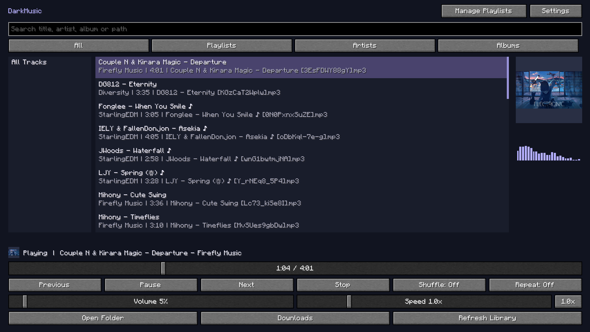

*Captured in fullscreen at Minecraft GUI scale 3 using a real music collection and its embedded artwork.*

## Music folders

### Use the default folder

Click **Open Folder** to find your selected music directory. The default folder
is created automatically inside your active Minecraft instance:

```text
config/
└── darkmusic/
    └── music/
```

This follows the instance launched through Prism Launcher, Modrinth App, the
Minecraft Launcher, or another Fabric launcher. There is no need to find a
launcher's installation directory yourself.

Organize files however you prefer. Nested folders are included automatically.
File watching checks for changes every few seconds; a fallback scan runs every
two minutes. Unchanged files reuse cached metadata. **Refresh Library** requests
an immediate scan, useful after missed changes or reconnecting a drive. Scanning
runs in the background.

### Choose an existing collection

1. Open **Settings → Choose Music Folder**.
2. Click directory buttons to navigate. **Up** goes to the parent folder and
   **Roots** lists drives or filesystem roots.
3. Alternatively, enter an absolute directory path and click **Browse**.
4. Click **Use This Folder** to activate the displayed directory.

**Previous** and **Next** page through directories. **Default** navigates to
the default music directory; click **Use This Folder** to select it.
**Cancel** or **Escape** returns without selecting a new location.

Different Minecraft instances can use the same music directory while keeping
their own playlists and settings.

### Supported formats

| Extension | Supported audio |
|---|---|
| `.mp3` | MP3, including variable-bitrate files |
| `.ogg` | OGG Vorbis |
| `.wav` | PCM WAV |
| `.flac` | FLAC |

Use mono or stereo audio. OGG Opus is a different codec from OGG Vorbis;
compressed WAV variants may need conversion to PCM WAV.

## Download music

Open **Downloads** at the bottom of the main player. The downloader uses the same
selected music folder and library as the player; choosing another folder in
**Settings → Choose Music Folder** also changes the destination for newly queued
downloads. Entries already queued keep their original destination.

### Set up the tools

Open **Tools** and provide executable file paths for **yt-dlp**, **FFmpeg**, and
**FFprobe**, then click **Check Tools**. Blank paths search the instance's
`config/darkmusic/tools` directory and system PATH; FFprobe is also searched for
alongside FFmpeg. Shell scripts are not executable-path substitutes.

Use the official [yt-dlp releases](https://github.com/yt-dlp/yt-dlp/releases) and
[FFmpeg downloads](https://ffmpeg.org/download.html). FFmpeg needs the
`libmp3lame` encoder. Existing installations can be reused. The mod checks tool
capabilities and does not install or update tools automatically.

For YouTube, install **Deno 2.3+** or **Node 22+** and optionally set its executable
path in the fourth field. Blank uses automatic lookup. Official yt-dlp standalone
executables include the YouTube challenge scripts; other distributions may need
additional setup described in the [yt-dlp JavaScript guide](https://github.com/yt-dlp/yt-dlp/wiki/EJS).
Settings save when leaving the screen, including with **Escape**.

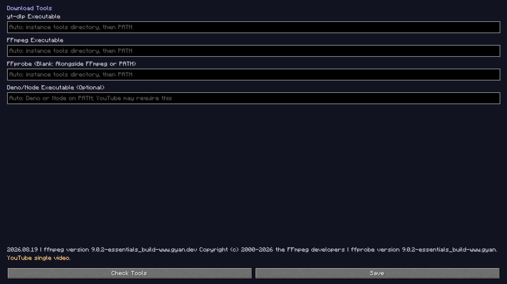

### Preview and choose entries

1. Paste a video or collection URL and click **Analyze**. This only previews it.
2. Cycle **Mode** to choose the intended selection before clicking Download.
3. Use **Show Queue / Preview** to watch results or return to the preview list.

| Mode | What is queued |
|---|---|
| This Video Only | One video, even if a YouTube watch URL also includes a playlist |
| Selected Preview | Checked entries; checks persist across preview pages |
| First N Entries | Entries 1 through the number in the first input |
| Entry Range | Start and end inputs, inclusive; `10` and `30` select entries 10–30 |
| All Entries | The known collection size, only after explicitly choosing this mode |

Preview pages contain up to **100 entries**. **Select Page** checks the current
page; **Clear Checks** clears checks on every page. Click rows to select them;
Control-click toggles individual checks and Shift-click selects a connected range.
Unavailable entries stay visible and are reported as failures when queued.

Each batch and queue supports up to **1,000 entries**. Clear finished rows and
use separate ranges for larger collections. Dynamic YouTube Mixes have no stable
end, so use checked entries, First N, or a range. A collection-only URL cannot
silently download all entries through **This Video Only**.

YouTube playlists and Mixes, Bilibili collections/favorites/series/multipart
videos, and other platforms depend on the installed yt-dlp extractor and the
site's current availability. For one part of a Bilibili multipart video, use
that part's URL. Private, deleted, restricted, or unsupported entries may fail;
the downloader does not bypass authentication, DRM, or access controls.

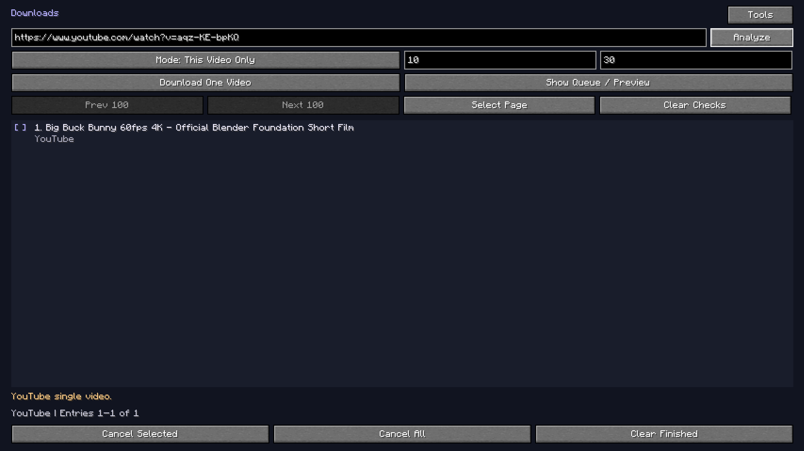

### Queue, files, and cancellation

The queue shows waiting, downloading, converting, saved, skipped, failed, and
cancelled items, available download percentages, and overall finished/failed
counts. Select a queue row to see its destination and current message.
**Cancel Selected** cancels that item. **Cancel All** also cancels URL analysis.
**Clear Finished** removes completed rows without deleting saved audio.
Closing the screen keeps downloads running; exiting Minecraft cancels unfinished
work. Pending queue rows are not restored on restart.

Completed audio is converted to MP3 and verified before entering the music
folder. Available title, artist/uploader, album, track number, and cover artwork
are retained; a collection position supplies the track number when no explicit
track number exists. Missing artist/album tags are not invented. Missing or
unusable artwork can produce an audio-only MP3 with a warning.

Stable source identifiers avoid filename collisions. The folder's
`.darkmusic-downloads.json` records completed downloads so repeating one is
skipped while its file exists. Keep this file to preserve duplicate detection.
Temporary work stays outside the library, and completed songs trigger the
existing background library refresh. Saved files remain playable after restart.

Failures do not stop other queued entries. The queue provides a short reason,
with diagnostic output in the Minecraft log. For **403**, check access and tool
updates; for **429**, wait before retrying. Network timeouts can be retried later.
For conversion problems, check FFmpeg/FFprobe and free space in both the instance
and music directories. A damaged duplicate-history file is preserved rather than
overwritten; back it up before attempting repairs.

## Browse and search

Search matches a song's title, artist, album, or relative file path. Use **All**,
**Playlists**, **Artists**, or **Albums**, then select a group on the left.
Shorter layouts use a **View** button to cycle between views.

Starting a song uses the displayed results as the playback queue. For example,
select an artist before playing to listen to that artist's songs.

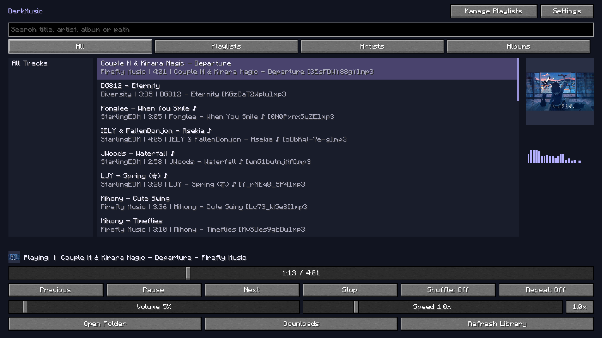

Use the mouse wheel to scroll. With the main song list focused, use **Up/Down**,
**Home/End**, or **Page Up/Page Down** to navigate and **Enter** to play.
**Tab** moves focus between controls.

### Song information and artwork

Title, artist, album, and artwork come from embedded file tags. Missing titles
fall back to filenames; missing artist or album tags show **Unknown artist**
or **Unknown album**. Folder names do not fill in these tags.

Use an audio-tag editor to update tags, save the files, and refresh the library.
Cover art must be embedded in the audio file; a nearby `cover.jpg` is not used.
Rectangular artwork is fitted proportionally with padding, without stretching
or cropping, in both the player and HUD.

The interface follows **Options → Language** and includes English and Traditional
Chinese. Song titles, artist names, filenames, and playlist names stay as supplied.

## Playback controls

| Control | Behavior |
|---|---|
| **Play / Pause / Resume** | Start the selected song when stopped; otherwise pause or resume playback |
| **Previous** | Go back through playback history, or restart the current song |
| **Next** | Advance through the queue |
| **Stop** | Stop and reset the playback position |
| Progress slider | Preview the position while dragging; seek once when you release |
| Volume slider | Change DarkMusic's volume independently of Minecraft sound sliders |
| **Shuffle: Off / On** | Keep the queue order or randomize it |
| **Repeat: Off / One / All** | Stop at the queue's end, repeat the current song, or repeat the queue |
| Speed slider | Choose **0.5×–3.0×** in **0.1× steps** |
| **1.0x** | Reset speed to normal |

Speed changes tempo **and pitch**: faster sounds higher, slower sounds lower.
It can change while playing or paused and is saved between launches. Progress
and seeking still refer to the original song's timeline, not elapsed listening
time. Use the arrow keys on the focused speed slider to step by 0.1×.

Manual **Next** advances even with repeat-one enabled; it stops at the queue's
end unless repeat-all is selected. Seeking through compressed files can take
a moment. Dragging previews the timestamp without repeatedly reopening the file;
release to seek once. You can change the position again or stop playback.

## Listen to playlists

Select the **Playlists** view, choose a playlist on the left, then double-click
a song in the main player. Selecting a playlist only browses its contents;
it does not interrupt the current song. Search filters the selected playlist.

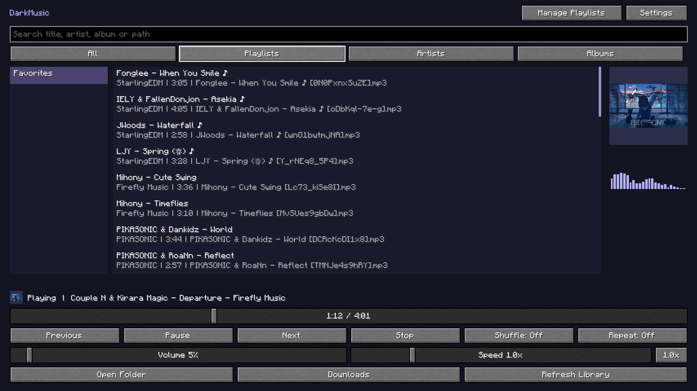

Missing files are skipped during playback and reported in the player. Empty
playlists show no songs instead of falling back to the whole library.

## Create and edit playlists

Open **Manage Playlists**. Playback controls stay in the main player; Escape
returns there after editing.

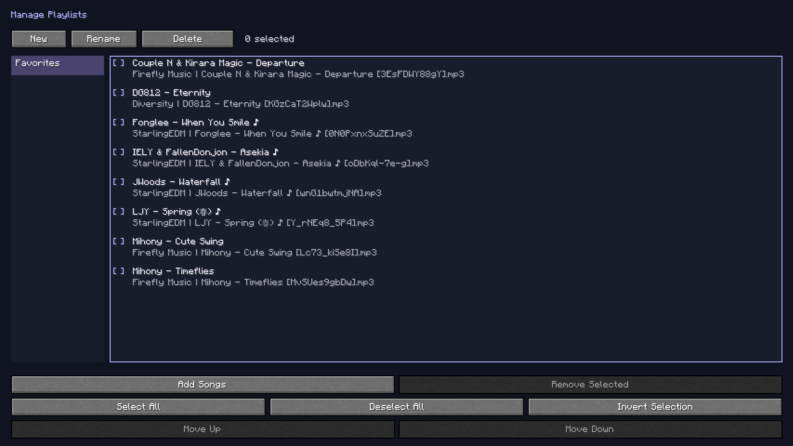

1. Click **New**, enter a name, and click **Save**.
2. Select the playlist on the left and click **Add Songs**.
3. Select songs using the checkboxes, selection buttons, or keyboard controls.
4. Click **Add Selected** to add them in library order. Songs already present
   in the playlist are hidden from the picker. If everything is already added,
   the picker shows an empty-state message and disables Add Selected.

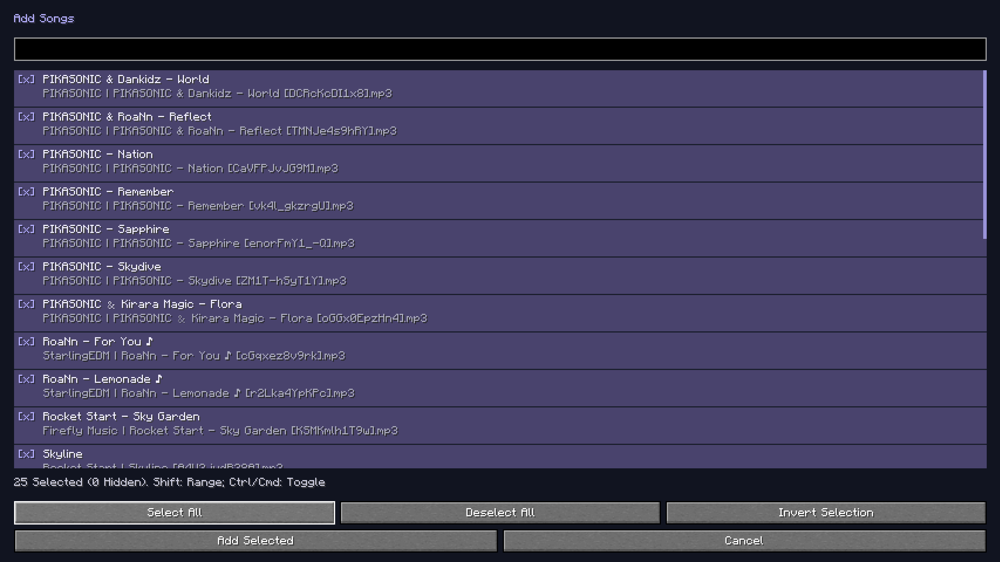

### Selecting multiple songs

| Input or action | Result |
|---|---|
| Click a checkbox | Toggle that song without clearing other selections |
| Click a song row | Select that song and clear other selections |
| **Ctrl/Cmd-click** | Toggle one song while keeping other selections |
| **Shift-click** | Select a range from the selection anchor |
| **Ctrl/Cmd+Shift-click** | Add a range to the current selection |
| **Space / Enter** with list focus | Toggle the focused song |
| **Shift+Up/Down** | Extend a range using the keyboard |
| **Ctrl/Cmd+A** with list focus | Select All visible songs |
| **Select All** | Add all visible songs to the selection |
| **Deselect All** | Clear the entire selection, including hidden songs |
| **Invert Selection** | Toggle visible songs while retaining hidden selections |

Searching in the picker keeps previous selections. The count tells you how many
selected songs are hidden by search; **Add Selected** includes them. **Cancel**
or **Escape** discards the pending additions. Adding is temporarily disabled
while a library scan is incomplete.

### Manage entries

Select entries using the same checkbox and keyboard controls, then use:

| Action | Result |
|---|---|
| **Remove Selected** | Remove checked entries from the playlist |
| **Move Up / Move Down** | Move checked songs while keeping their relative order |
| **Rename** | Change the selected playlist's name |
| **Delete → Confirm Delete** | Delete the selected playlist |

Drag a song by its text to insert it at another position. Adjacent selected
songs move together, keeping their order. If your selections form separate
groups, only the connected group containing the dragged song moves; other
selected groups stay in place. A floating preview and insertion marker show
the destination, and surrounding rows animate as they move aside.

Hold near the list's top or bottom to scroll while dragging. Drop inside the
list to save the order once. **Escape** cancels the drag without leaving the
editor; dropping outside the list also cancels it. **Move Up / Move Down**
remain available for keyboard use.

For a moved or renamed file, remove its missing entry and use **Add Songs**
to add the current file. The old replacement action has been removed.

Playlist edits save automatically and do not modify the audio files themselves.

## Settings and now-playing HUD

General settings contain **Autoplay on Launch** (off by default),
**Choose Music Folder**, and **Suppress Vanilla Background Music**. Suppression
affects background music while ordinary sound effects remain available.
Volume, speed, shuffle, and repeat are controlled in the main player.
Setting labels align left. An empty square on the right means off, and a checked
square means on. Click the row or use Space/Enter while it is focused to toggle.
Action rows have an arrow instead of a state checkbox; the bottom button switches pages.

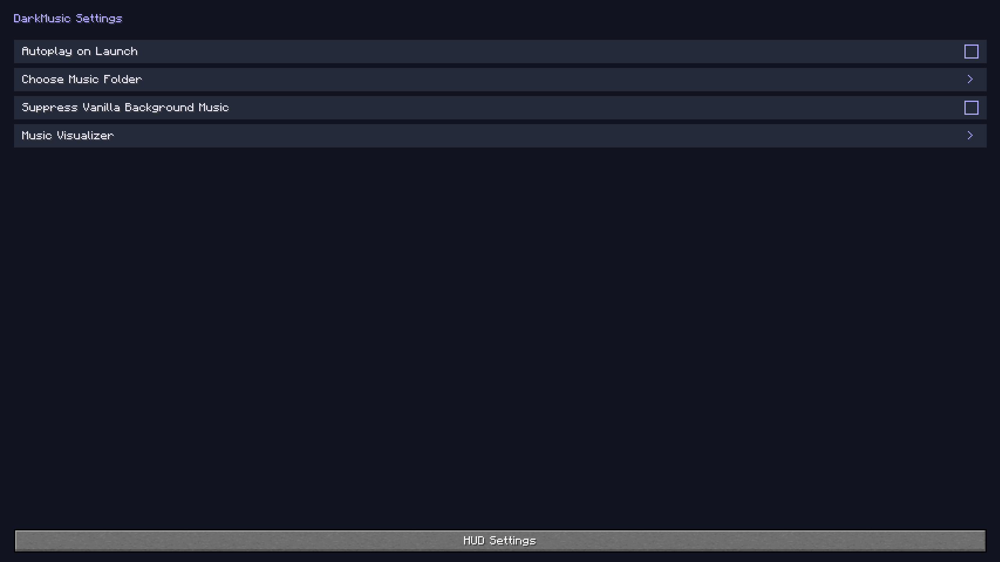

Open **Settings → HUD Settings** to configure:

- **Now-Playing HUD:** show the title, artist, and playback status during gameplay.
- **HUD Artwork:** show available embedded artwork on the left; enabled by default.
- **HUD Progress:** show the track's progress indicator.
- **Edit HUD Layout:** drag the HUD and change its whole-panel scale.

The HUD starts disabled. It respects Minecraft's **F1** visibility toggle and
hides while menus are open. When artwork is absent or disabled, text uses the
available space.

### Move and scale the HUD

1. Open **Edit HUD Layout**.
2. Drag the preview to your preferred position.
3. Adjust **HUD Scale** between **50% and 200%**, in 10% steps.
4. Press **Escape** to save and return.

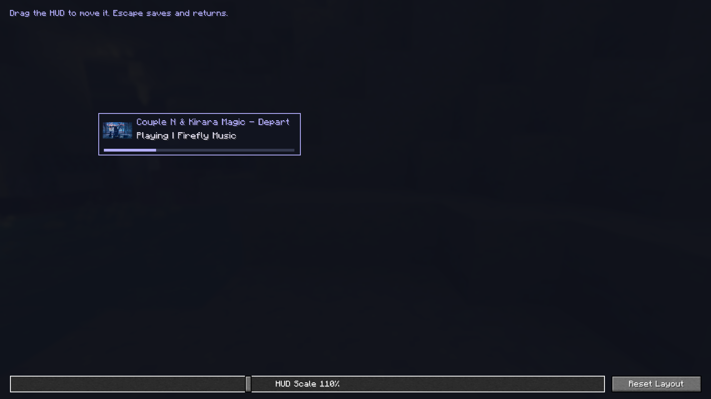

The preview works even when playback is stopped or the HUD is disabled.
**Reset Layout** restores top-left placement and 100% scale. Position is stored
relative to the available screen area so the HUD remains visible across window
sizes and GUI scales. Older corner-based positions migrate automatically.

### Keyboard shortcuts

Open **Options → Controls → Key Binds**, then find the **DarkMusic** category.
Use Minecraft's binding controls to assign or clear a key. Conflicting DarkMusic
shortcuts are disabled until you choose a free key. There is no separate binding
screen in the mod's settings.

| Action | Default |
|---|---|
| Open music player | **M** |
| Play / pause | Unassigned |
| Next / previous track | **Right Arrow / Left Arrow** |
| Volume up / volume down | **Up Arrow / Down Arrow**; each press changes volume by 5%, bounded to 0–100% |
| Speed up / speed down | Unassigned; each press changes speed by 0.1× |
| Reset speed | Unassigned; returns to 1.0× |

Global shortcuts work during gameplay with menus closed. Use the on-screen
controls while the player is open.
These are ordinary arrow-key bindings; no special keyboard media keys are
required. Defaults apply to new bindings. Updating the mod preserves existing
saved assignments, including unbound keys. Use Minecraft's Reset control to
apply a binding's new default.

## Music visualizer

Open **Settings → Music Visualizer**. The player visualizer starts enabled;
the HUD visualizer starts disabled. Each has its own toggle, independent of the
now-playing text/artwork HUD.

Player bars occupy the existing right-hand space beneath artwork. Compact
layouts use the right side of the status row, without moving playback controls.
The spectrum comes from actual decoded audio after playback-speed and volume
processing. It uses FFT frequency bands from bass to treble; no simulated bars
appear when audio is absent. Analysis and smoothing run on the audio worker,
timed against the sound device's played-frame position.

| Setting | Effect |
|---|---|
| Music-Player Visualizer | Show bars in the main player |
| HUD Visualizer | Show an independent gameplay spectrum; respects F1 and menu visibility |
| Bars | 8–64 frequency bands, in steps of four; narrow areas combine bands to fit |
| Sensitivity | 0.25×–4× visual gain, without changing playback volume |
| Smoothing | Faster or slower attack/decay; higher values respond more slowly |
| HUD Width | 80–320 GUI pixels, limited to the available screen width |
| Height | 24–120 GUI pixels for the HUD and preferred player height, limited by available space |

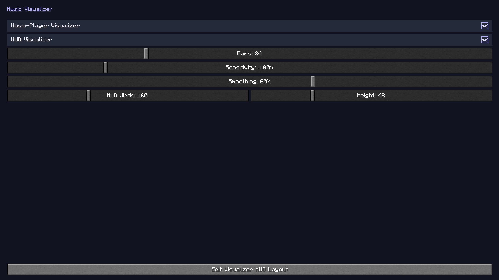

Choose **Edit Visualizer HUD Layout** and drag the real spectrum anywhere on the
screen. **Reset Position** restores right-side placement. Position is stored
relative to available space, so it remains on screen across GUI scales. Play
music for a live preview; stopped playback shows no invented animation.
**Escape** saves and returns.

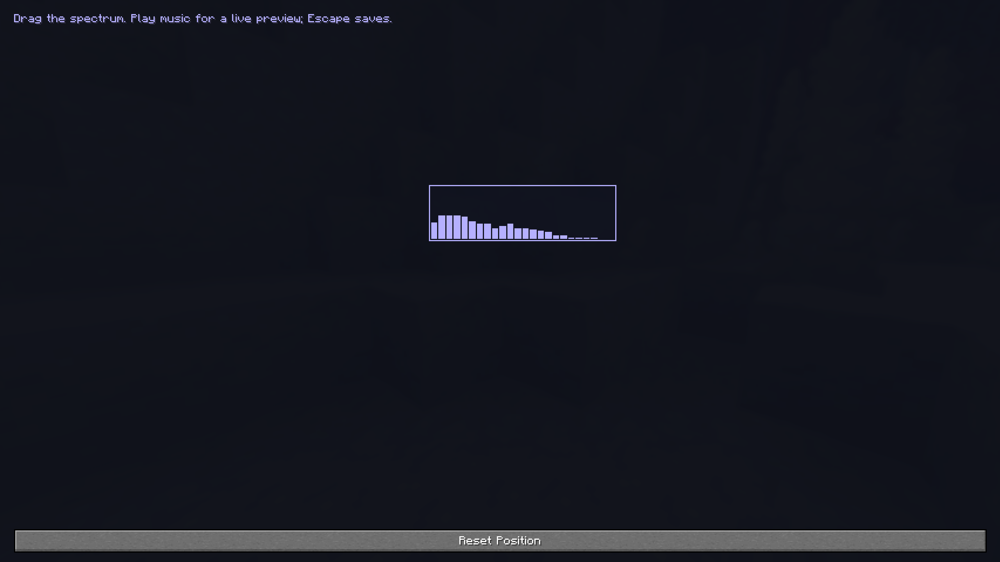

Pausing freezes the current spectrum. Seeking, stopping, loading another track,
or playback errors clear old levels; resuming produces fresh audio-driven bars.
Quiet music or low DarkMusic volume can produce short bars; increase Sensitivity
if desired. Speed changes also change the audible frequencies and the spectrum.

## Troubleshooting

| Symptom | Try this |
|---|---|
| Empty library | Open the folder, check supported files, clear search, select **All**, and refresh |
| New file not appearing | Wait for file discovery or click **Refresh Library** |
| Missing artist/album/artwork | Update the embedded tags, save the audio file, and refresh |
| Missing playlist song | Remove that entry in Manage Playlists, then use **Add Songs** to add the current file |
| Add Songs picker is empty | Every available library song is already in this playlist; clear search or scan for new files if needed |
| Add Selected disabled | Select at least one song and wait for the library scan to finish |
| Unavailable folder | Reconnect the drive or choose another music folder |
| Music sounds too high/low | Set the speed to **1.0x** |
| HUD not visible | Enable it, start a song, close menus, check F1, or reset its layout |
| Shortcut not working | Assign a free key; check the conflict message |
| No sound | Check player volume, output device, and playback status; try another supported file |

Transient warning messages clear automatically after ten seconds. Ongoing
library/audio errors remain visible in the player's status; logs retain details.

## Keep settings between installations

Each instance stores settings in `config/darkmusic/config.json` and playlists
in `config/darkmusic/playlists.json`. Close Minecraft before copying these
files to another instance, then select the same music collection there.
Settings and playlists are saved in the active Minecraft instance.

[Back to the project overview](../README.md)
