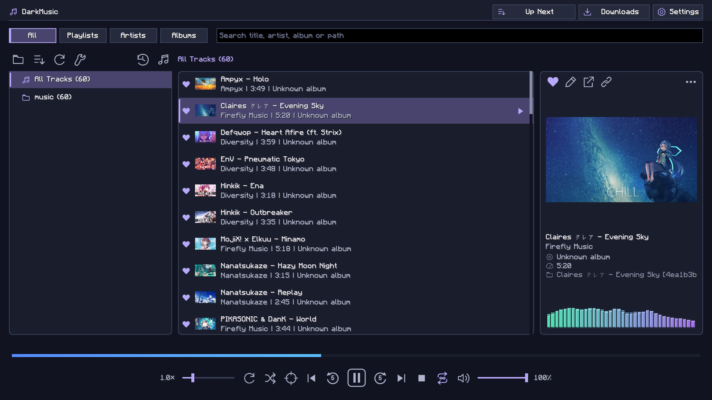
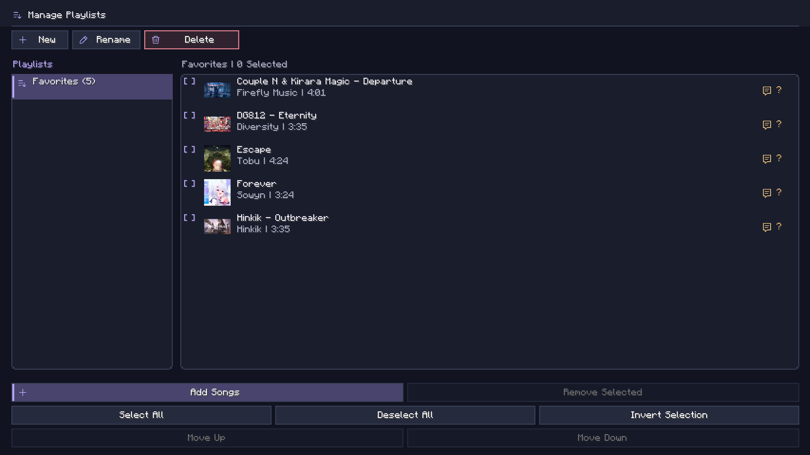
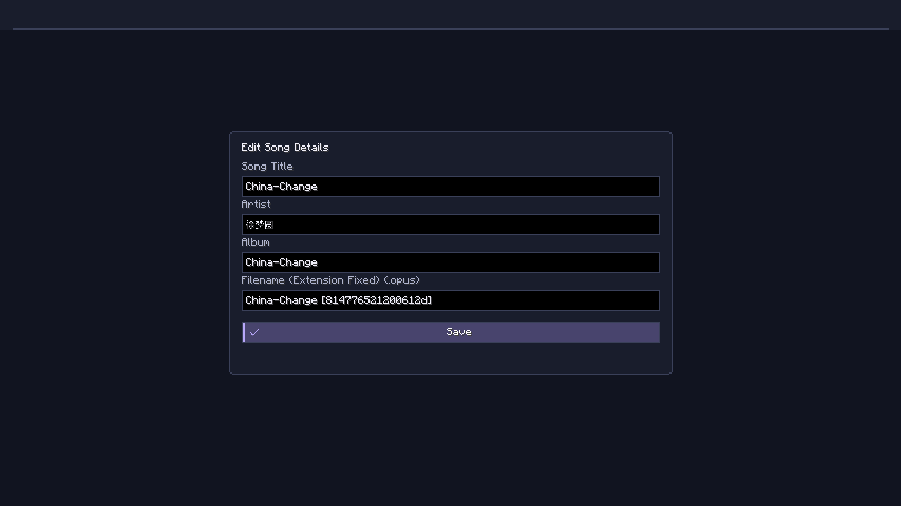
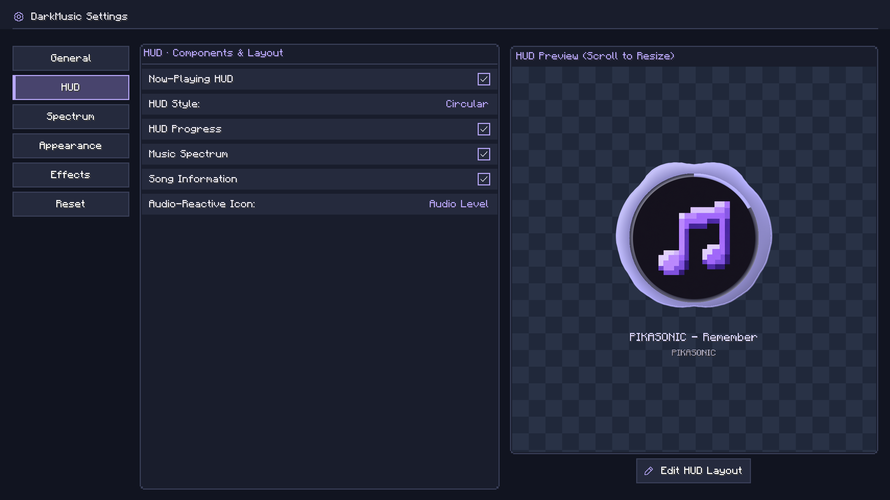
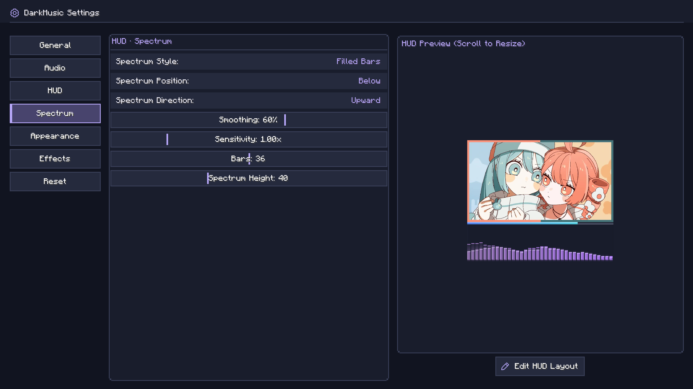
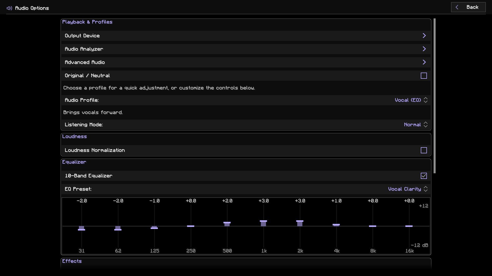

# DarkMusic User Guide

This guide describes DarkMusic v2.2.0 for Minecraft 26.2 with Fabric and Java 25.

## Interface language

DarkMusic includes English and Traditional Chinese (Taiwan). Choose **繁體中文（台灣）** in Minecraft's **Options → Language** menu to use Traditional Chinese. Song names and other music metadata remain as supplied by your files.

## Add your music

Press **B**, open **Settings**, and choose **Choose Music Folder**. A native folder picker opens. The selected path appears below the setting. DarkMusic scans that folder and its subfolders.

The default folder is `config/darkmusic/music` inside your Minecraft instance. Copying music there also works. Library changes are discovered automatically; use Refresh Library if a change has not appeared.

**Use Default Music Folder** in General settings restores that path. It leaves audio in its existing location. Refresh Library sits beside Import History in the player; narrow layouts place these actions in Collections.

MP3, FLAC, WAV, Ogg Vorbis, and AIFF use the bundled audio readers. Opus, AAC, MP4/M4A, and WebM playback uses FFmpeg. These formats require a compatible FFmpeg installation, available through **Downloads → Tools**. Actual playback depends on the codec in the file.

Titles, artists, albums, duration, and artwork are read from available metadata. Missing metadata may appear as a filename or an unknown artist/album. Use the player's pencil button to edit a selected song's tags.

### Drag and import

Drag one or more audio files into the music player or playlist manager. DarkMusic copies the files into the configured music folder; the originals stay where they are. Imported songs appear automatically. Existing destination files are kept, with a numbered filename used for a new copy when necessary.

The destination follows the selected collection:

| Selected view | Import destination |
|---|---|
| All Tracks | Music folder root |
| A folder in All | That folder |
| A playlist, including Favorite Music | Music folder root, with entries added to that playlist |
| Artists, Albums, or no valid collection | Music folder root |

Import feedback appears while files from a real drop are copied. File acceptance uses Minecraft's normal file-drop handling.

Open **Import History** beside Open Folder to review import times, filenames, destinations, and success or failure results.

## Browse and play



Choose **All**, **Playlists**, **Artists**, or **Albums**. The left panel shows collections and track counts. In All, folder disclosure symbols expand nested folders; folders start collapsed.

Search filters the visible list. Select a song and press Play, or double-click it. The right panel shows the selected song's details and artwork. It can show a different song from the one currently playing.

The centered controls are:

**Reset Speed · Speed · Shuffle · Jump to Playing · Previous · Play/Pause · Next · Stop · Repeat · Volume · Mute/Unmute**

Drag the speed or volume marker, or focus the slider and use the arrow keys. Speed ranges from **0.5× to 3.0×** in 0.1× steps; speed changes also change pitch. Reset Speed returns to 1.0×. Mute/Unmute restores the last audible volume when unmuting. Supported controls show their current key bindings in hover help. Drag or click the filled progress track above the controls to seek.

Repeat cycles between:

| Mode | Behavior |
|---|---|
| Off | Stop at the end of the collection |
| This | Repeat the current song |
| All | Repeat the collection |

Shuffle randomizes that same collection. Starting a song from a search still uses the full folder, playlist, artist, album, or All Tracks collection. **Jump to Playing** returns to that source collection, clears search, and reveals the song.

Long labels can be scrolled horizontally with a horizontal wheel gesture or Shift + wheel. Song rows do not display hover popups. **Show Hover Info** controls help on settings and other controls. Escape returns to the previous screen.

## Manage playlists



Open the Playlists view, then **Manage Playlists**. Create or rename a playlist, and use **Add Songs** to choose tracks. Songs already in the playlist are omitted from the picker.

Use selection controls or Ctrl/Cmd-click to select individual songs. Shift-click extends a selection. Ctrl/Cmd+A selects the list. Connected selections can be dragged together to change their order; Move Up and Move Down provide button controls.

Remove Selected removes playlist entries. Deleting a playlist opens a confirmation dialog. Neither action deletes your audio files. After a complete library scan, confirmed missing tracks are automatically removed from playlists and Favorite Music. Offline or inaccessible folders and incomplete scans do not trigger this cleanup.

Play playlists from the main player's Playlists view.

### Favorite Music

Click the heart in the selected song's right-hand panel to add or remove it from **Favorite Music**. A filled heart marks a favorite; liking a song briefly animates the button. Favorite songs also show a small filled heart before their artwork in the track list.

Favorite Music is a built-in playlist with a heart icon in both playlist views. It supports adding, importing, reordering, and removing songs. Its name and playlist cannot be deleted or renamed.

### Edit song details



Select a song and click the pencil in its details panel to edit the title, artist, album, or filename. The filename field contains only the name; the file extension is kept automatically. Saving writes the metadata to the audio file and updates the library and playlist references.

If that song is playing, saving briefly releases its playback handle and resumes at the previous position and playing/paused state. Renaming also keeps matching lyric sidecars with the song. Unsupported tag formats or failed writes show an error. Opus and WebM tagging requires FFmpeg. Back up important files before deliberately editing their tags.

The details actions are Heart, Pencil, Open Source, and Copy Source Link. Source actions are available when DarkMusic knows the original video URL. Copy Source Link displays **Copied!** after successful copying. Downloads record source associations, which follow imported or renamed files. The actions are hidden when the panel has no selected song.

## Download music

Open **Downloads** from the player.

### Set up tools

Open **Tools → Install / Update Tools**. Managed setup downloads compatible yt-dlp, FFmpeg/FFprobe, and Deno executables. Updates are requested from this menu. Allow up to 1 GB of temporary space.

Under **Advanced Paths**, select existing executables if preferred. Blank paths use managed tools or system lookup. Check Tools reports whether the selected tools can run. External tool publishers and source links are listed in the tools menu.

Managed installation supports Windows x64, Linux x64/ARM64, and macOS x64/ARM64. Windows ARM64 requires compatible externally installed tools. Internet access and website changes can affect downloads.

### Analyze and select

1. Paste a video or collection URL.
2. Choose **Analyze**.
3. Choose This Video Only, Selected Entries, Entry Range, or All Entries, as available.
4. Review the selection, then download.

YouTube videos/playlists/Mixes, Bilibili videos and supported collections, and other yt-dlp-supported sources can be analyzed. A source may expose only some collection types or entries.

Preview pages contain up to 100 entries. Use Previous/Next, or enter a page number and press **Go** or Enter. Direct page selection is restricted to available pages. For collections with an unknown end, first reach later pages with Next; direct jumps can return to pages already reached.

Search filters the current entry page by title or entry number. Select Page checks visible results. Selections persist across pages. Entry Range downloads its inclusive range, such as 10–30; checked entries are used only in Selected Entries mode. Batches are limited to 1,000 entries. Unknown-ended collections require a finite range.

Select an available entry and use the preview Play button to hear up to 30 seconds. The same button pauses or resumes the excerpt; a separate Stop button ends it. Preview needs a network request and may take a moment. It stops when leaving the menu. The URL and analyzed preview remain available when returning.

### Queue and files

Downloads run in the background, including when the menu is closed. Up to three jobs run in parallel; conversion and source restrictions can limit throughput. A HUD indicator reports background progress.

Queue search covers titles, status, errors, and destination folders. **Retry Selected** retries one failed job; **Retry Failed** retries all failed jobs. Automatic retries run after pending work, up to three retries per job. Clear Finished keeps failed jobs; Clear Failed removes their queue records. Cancellation stops active/queued work; completed files remain.

Completed files go into the currently configured music folder and appear in the library. **Audio Options → Download Audio Format** chooses Original / Best Available or Convert to MP3. Available title, uploader/artist, album, track number, and artwork are embedded where supported. Duplicate tracking reduces repeat downloads.

Restricted, deleted, private, or unsupported content may fail. DarkMusic does not bypass authentication or DRM. Download only material you are authorized to save.

## Customize the HUD


Settings contains General, HUD, Spectrum, Appearance, Effects, and Reset sections. Most changes save immediately. The preview shows current playback data, or sample visualization when no song is playing.

**Now-Playing HUD** enables the whole in-game component:

- **Classic:** song information with optional artwork, progress, and spectrum.
- **Circular:** the DarkMusic icon, circular progress, outward spectrum, and optional title/artist text.
- **Artwork:** larger, aspect-preserving artwork and spectrum. An optional progress bar touches the bottom of the image. Position the spectrum above, below, left, or right; side spectra grow horizontally away from the image. The whole layout moves and scales as one HUD.



Choose a spectrum style, bar count, sensitivity, smoothing, and height in every layout. Above/below spectra support upward or downward growth. Appearance offers colors, background transparency, and flat or beveled finishes. Classic and Artwork share solid/gradient background controls; background transparency does not fade the artwork or other foreground content. Effects provides quality presets, frequency smoothing, peak hold, trails, and glow.

Color editors offer **Color Spectrum** or **RGB** mode, one at a time. In Color Spectrum, choose a hue on the rainbow strip and saturation/brightness in the field above it. Palette colors, **#RRGGBB** input, and **Default** remain available. General settings also has menu background/accent colors. Gradient presets are paged so all choices remain reachable.

New installations and Reset to Defaults use 100% HUD background transparency, Enhanced visualizer quality, Beveled spectrum/progress finishes, and Ocean Drive colors. Lyrics start disabled. Existing saved choices are retained when upgrading.

For Circular HUD, **Audio-Reactive Icon** selects **Off**, **Audio Level**, or **Beat**. Audio Level follows the music's energy; Beat pulses on detected onsets. Quality presets can also select the underlying beat-reactive mode. Settings sliders use a vertical handle without a filled horizontal track.



The spectrum analyzes decoded music samples. Pause freezes it; seeking, stopping, and track changes reset its analysis state.

Scroll over the settings preview to resize that preview. Its scale is independent of the saved in-game HUD scale.

Use **Edit HUD Layout** beneath the preview, or `/da gui`, to position the actual HUD. Drag it to move; scroll over it to change its scale in 10% steps from 50% to 300%. A scale indication appears while resizing. Escape saves and returns. The HUD and its spectrum move as one component.

## Audio options



**Original / Neutral** bypasses optional audio processing. Turn it off to adjust normalization, equalizer, bass, stereo width, compression, reverb, or limiting. Volume, speed, and listening mode have their own controls.

Profiles provide presets, plus named saved configurations. A trash button beside each saved profile opens a deletion confirmation. Deleting a saved profile leaves the current sound settings active; built-in profiles remain available. The 10-band equalizer supports presets and individual adjustments. Loudness normalization uses available tags; Analyze Untagged Loudness can measure missing loudness information with FFmpeg. Album mode uses album loudness tags when available.

Gapless playback preloads consecutive songs. Crossfade sets overlap duration. Listening Mode offers Normal, Focus (quieter game sounds), and Ambient (quieter music). Duck on Priority Sounds briefly reduces music for important game sounds, with level and timing controls.

## Lyrics

**Enable Lyrics** controls lyric display and downloading source captions. **Lyrics in HUD** and **Show Next Lyric Line** control HUD lines. The Lyrics screen displays synchronized text for the current song.

For a local sidecar, place `Song.lrc` beside `Song.mp3` (or another supported audio file) with the same basename. Lyrics need timed lines, for example:

```text
[00:12.30]First line
[00:16.80]Second line
```

Supported embedded lyric tags can also provide synchronized text. Plain untimed text is not enough for synchronized playback. Oversized sidecars and unsupported embedded formats may not be read.

**Preferred Lyrics Language** accepts ordered language preferences and regional variants. Auto follows Minecraft's interface language. Downloading prefers matching manual captions; unavailable preferred languages do not cause an arbitrary other language to be selected. Translated captions and video metadata language are not treated as proof of a song's language.

Local-library indicators distinguish validated timed lyrics, no supported lyrics, and unknown/unread data. Download analysis results do not show lyrics availability or run per-video checks for that field. Many videos have no matching captions, and captions may contain speech. The downloader does not generate lyrics or transcribe audio, so not every song gets a lyrics file.

## Shortcuts and commands

| Action | Default key |
|---|---|
| Open player | B |
| Play / pause | Backslash |
| Previous / next track | [ / ] |
| Volume down / up | Down / Up arrow |
| Speed down / up | Left / Right arrow |
| Reset speed | Numpad 0 |
| Mute / unmute | M |

Volume changes in 5% steps and speed in 0.1× steps. Volume, mute, and speed shortcuts briefly show a HUD notification. Rebind controls in Minecraft's Key Binds menu under DarkMusic.

| Command | Action |
|---|---|
| `/da` or `/darkmusic` | Open player |
| `/da gui` or `/darkmusic gui` | Edit HUD layout |
| `/da help` or `/darkmusic help` | Show local tips and links |

These commands are handled client-side; help feedback is shown locally.

## Saved data and reset

Settings, playlists, and import history are stored in the instance's `config/darkmusic` directory. Your configured music folder can be elsewhere. Keep that configuration directory with your library when backing up playlists and preferences.

**Reset to Defaults** opens a confirmation dialog. It restores settings, key binds, HUD layout/scale, volume, speed, and the default music folder path. It stops work and clears recognized download history, import history, and caches. Your audio/video files, playlists, installed download tools, and configured executable paths are kept. Clearing download history allows the same sources to be downloaded again.

## Troubleshooting

| Problem | What to check |
|---|---|
| Empty library | Confirm the folder in Settings and the audio file format; use Refresh Library |
| Opus/M4A/WebM will not play | Install or select working FFmpeg/FFprobe in Download Tools |
| Artwork missing | Check whether the file contains supported embedded artwork |
| Lyrics missing | Check Enable Lyrics, timed data, matching `.lrc` basename, and source caption availability |
| HTTP 403 or 429 | Check public access, update tools, or wait before retrying |
| HUD missing | Enable Now-Playing HUD and start music; check HUD layout |
| Effects unavailable | Turn Original / Neutral off |
| Shortcut conflict | Rebind it in Minecraft's Key Binds menu |

For a reproducible issue, share the mod/Minecraft versions, operating system, steps, and relevant logs in [GitHub Issues](https://github.com/DarkLian/DarkMusic/issues). Remove private details before posting.
