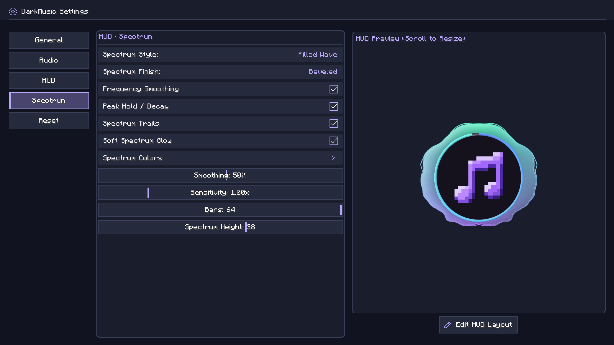

# DarkMusic User Guide

This guide describes DarkMusic v2.5.1 for Minecraft 26.2 with Fabric and Java 25.

## Interface language

DarkMusic includes English and Traditional Chinese (Taiwan). Choose **繁體中文（台灣）** in Minecraft's **Options → Language** menu to use Traditional Chinese. Song names and other music metadata remain as supplied by your files.

## Add your music

Press **B**, open **Settings → General → Music Folders**, and choose **Add Music Folder**. A native folder picker opens. Register multiple folders to scan them and their subfolders together. The checked **Default Save Folder** receives downloads and imports without a selected folder. Selecting a save destination preserves folder order. Removing a scan folder leaves its files on disk.

The default folder is `config/darkmusic/music` inside your Minecraft instance. Copying music there also works. Library changes are discovered automatically; use Refresh Library if a change has not appeared.

Folders scan independently, so a slow or unavailable network folder does not hold back results from healthy folders. Partial or failed scans retain previously indexed songs while adding newly discovered entries; only successful scans remove missing entries. Adding or removing a scan folder preserves entries for still-registered folders. Changing only the Default Save Folder leaves the library and current scans in place.

**Open Folder** opens the root or subfolder selected in the player's All view. All Tracks, playlists, artists, and albums use the Default Save Folder instead. Hover over the button to see its destination.

**Use Built-In Save Folder** in Music Folders restores that save destination while retaining other registered scan folders. It leaves audio in its existing location. Refresh Library sits beside Import History in the player; narrow layouts place these actions in Collections.

MP3, FLAC, WAV, Ogg Vorbis, and AIFF use the bundled audio readers. Opus, AAC, MP4/M4A, and WebM playback uses FFmpeg. These formats require a compatible FFmpeg installation, available through **Downloads → Tools**. Actual playback depends on the codec in the file.

Titles, artists, albums, duration, and artwork are read from available metadata. Missing metadata may appear as a filename or an unknown artist/album. Use the player's pencil button to edit a selected song's tags.

### Drag and import

Drag one or more audio files into the music player or playlist manager. DarkMusic copies the files into the configured music folder; the originals stay where they are. Imported songs appear automatically. Existing destination files are kept, with a numbered filename used for a new copy when necessary.

The destination follows the selected collection:

| Selected view | Import destination |
|---|---|
| All Tracks | Music folder root |
| A folder in All | That folder |
| A playlist, including Favorite Music | Music folder root, with entries added to that playlist |
| Artists, Albums, or no valid collection | Music folder root |

Import feedback appears while files from a real drop are copied. File acceptance uses Minecraft's normal file-drop handling.

Open **Import History** beside Open Folder to review import times, filenames, destinations, and success or failure results.

## Browse and play


Choose **All**, **Playlists**, **Artists**, or **Albums**. The left panel shows collections and track counts. In All, folder disclosure symbols expand nested folders; folders start collapsed.

Search filters the visible list. Select a song and press Play, or double-click it. The right panel shows the selected song's details and artwork. It can show a different song from the one currently playing. Play starts that selection; Pause/Resume controls the current song only when both the song and its source collection match. The right-side spectrum follows that same rule. Track changes automatically reveal the playing song and its source collection when the search is empty and not focused. An active search keeps its text, cursor, and focus while music continues normally.

The player uses larger borderless playback and utility icons. Volume has a slim filled track and percentage readout; Speed has a matching filled track and a multiplier on its left. The player controls are centered independently of the song list. Speed and Volume sliders sit at the outer edges, with Reset Speed and Mute beside the playback buttons. All controls use equal horizontal spacing. In the three-column layout, the song list is also centered; the details panel keeps its usual width.

The centered controls are:

**Speed · Reset Speed · Shuffle · Jump to Playing · Previous · Back 5 Seconds · Play/Pause · Forward 5 Seconds · Next · Stop · Repeat · Mute/Unmute · Volume**

Drag the speed or volume marker, or focus the slider and use the arrow keys. Speed ranges from **0.5× to 3.0×** in 0.1× steps; speed changes also change pitch unless Preserve Pitch is enabled in Advanced Audio. Reset Speed returns to 1.0×. Mute/Unmute restores the last audible volume when unmuting. Supported controls show their current key bindings in hover help. Drag or click the filled progress track above the controls to seek.

Space toggles Play/Pause while the player is open. DarkMusic shortcuts also work after clicking player controls. Press Tab to navigate controls with the keyboard; arrows and Space then operate the focused control. Any mouse click leaves Tab navigation. Search keeps normal typing and blocks playback shortcuts while focused; click empty space to release it. Manual Previous and Next wrap through the playback collection regardless of repeat mode.

Repeat controls what happens when a song finishes, cycling between:

| Mode | Behavior |
|---|---|
| Off | Stop at the end of the collection |
| This | Repeat the current song |
| All | Repeat the collection |

Shuffle randomizes that same collection. Starting a song from a search still uses the full folder, playlist, artist, album, or All Tracks collection. **Jump to Playing** returns to that source collection, clears search, and reveals the song.

Long labels can be scrolled horizontally with a horizontal wheel gesture or Shift + wheel. Song rows do not display hover popups. **Show Hover Info** controls help on settings and other controls. Escape returns to the previous screen.

## Listening history

Use the history-clock icon immediately left of Manage Playlists above the collection list. Choose Recently Played or Most Played to browse play counts, listening time, and last-played dates.

Listening time follows audible playback rather than elapsed screen time. Pausing, seeking, and muting do not add listening time. A play counts after 30 seconds or half of a shorter song. Playback started from History keeps both history lists in their current order until you start playback from another collection. Statistics continue recording during that time.

Use **Settings → General → Clear Listening History** to clear these statistics. Audio files and playlists are kept.

## Backup and restore

Open **Settings → General → Backup / Restore**. Export Backup saves a ZIP containing settings, audio/environment profiles, playlists, DarkMusic key bindings, and listening history. It contains no music files, download tools, or artwork assets. Export preparation and ZIP writing run in the background.

Open Backup shows a restore preview. Select the categories to restore and choose whether to merge or replace playlists and history. Selected settings and key bindings replace their current values. Song references can be remapped to the current music folder using relative file paths. Unmatched references are retained for later matching.

Restore asks for confirmation and creates recovery copies of affected data. The current music folder path, tool paths, and audio output selection remain local to the installation. Copy your audio files separately when moving a library to another computer. If a restore is interrupted, DarkMusic recovers the previous setup on the next launch before loading it. If recovery is blocked by storage or permission problems, fix the reported problem and restart; recovery copies are retained.

## Audio output

Open **Settings → Audio → Audio Options → Output Device** to select an available Java Sound output device. System Default uses the operating system's default playback route. Refresh the list after connecting a device.

Switching preserves playback position and pause state when the destination supports the audio format. A rejected switch keeps the previous route. An unavailable saved device can fall back to System Default. Device names and hot-plug behavior depend on the operating system; Bluetooth and Linux/macOS behavior have not been manually verified for this release.

## Manage playlists


Open **Manage Playlists** with the music-note button above the collection list. Playlist creation, rename, and delete actions sit above the left list; Add Songs and Remove Selected sit above the song list. Selection actions are below the songs. Create or rename a playlist, and use **Add Songs** to choose tracks. Songs already in the playlist are omitted from the picker.

Use selection controls or Ctrl/Cmd-click to select individual songs. Shift-click extends a selection. Ctrl/Cmd+A selects the list. Connected selections can be dragged together to change their order.

Remove Selected removes playlist entries; removing multiple entries asks for confirmation. Deleting a playlist also opens a confirmation dialog. Neither action deletes your audio files. Successfully completed folder scans remove confirmed missing tracks from playlists and Favorite Music. Offline or inaccessible folders and incomplete root scans do not trigger cleanup for those folders.

Play playlists from the main player's Playlists view.

### Favorite Music

Click the heart in the selected song's right-hand panel to add or remove it from **Favorite Music**. A filled heart marks a favorite; liking a song briefly animates the button. Favorite songs also show a small filled heart before their artwork in the track list.

Favorite Music is a built-in playlist with a heart icon in both playlist views. It supports adding, importing, reordering, and removing songs. Its name and playlist cannot be deleted or renamed.

### Edit song details

Select a song and click the pencil in its details panel to edit the title, artist, album, or filename. The filename field contains only the name; the file extension is kept automatically. Saving writes the metadata to the audio file and updates the library and playlist references.

If that song is playing, saving briefly releases its playback handle and resumes at the previous position and playing/paused state. Renaming also keeps matching lyric sidecars with the song. Unsupported tag formats or failed writes show an error. Opus and WebM tagging requires FFmpeg. Back up important files before deliberately editing their tags.

The details actions are Heart, Pencil, Lyrics (when enabled), Open Source, and Copy Source Link. Source actions are available when DarkMusic knows the original video URL. Copy Source Link displays **Copied!** after successful copying. In narrow panels the confirmation appears as a brief tooltip. Downloads record source associations, which follow imported or renamed files. The actions are hidden when the panel has no selected song.

### Delete audio files

Open **Manage Audio Files** with the wrench above the player's collection list, or from **Settings → General → Music Folders**. Search the library, select one or more files, and choose **Review Selected Files**. The review shows full file paths before deletion. The song-details editor also offers **Delete Audio File…** for a single file.

Use **Move to Trash** when the operating system supports it. **Delete Permanently…** requires a separate confirmation and cannot be undone through DarkMusic. A failed Trash operation never switches to permanent deletion automatically.

Only the reviewed audio files are removed. Folders, lyric sidecars, and other accompanying files are kept. Successfully deleted tracks are removed from playlists and Favorite Music; failures remain available to review and retry. File changes detected after review require a fresh review.

During deletion, **Cancel Remaining Files** stops pending work. An already-issued Trash operation finishes or reaches its timeout before its outcome is reported. Completed deletions remain completed, and untouched pending files are listed as canceled rather than failed. To delete canceled files later, select and review them again in Manage Audio Files.

Deletion briefly releases playback handles. A surviving current song resumes at its previous position and playing/paused state; deleting the current song leaves playback stopped. File operations run in the background. On Windows, Trash operations preserve fullscreen, and F11 remains available to change window mode.

## Download music

Open **Downloads** from the player. Wide windows use a source bar, a left navigation/selection panel, and a right preview or queue panel. Compact windows retain accessible stacked controls.


### Set up tools

Open **Tools → Install / Update Tools**. Managed setup downloads compatible yt-dlp, FFmpeg/FFprobe, and Deno executables. Updates are requested from this menu. Allow up to 1 GB of temporary space.

Under **Advanced Paths**, select existing executables if preferred. Blank paths use managed tools or system lookup. Check Tools reports whether the selected tools can run. External tool publishers and source links are listed in the tools menu.

Managed installation supports Windows x64, Linux x64/ARM64, and macOS x64/ARM64. Windows ARM64 requires compatible externally installed tools. Internet access and website changes can affect downloads.

### Analyze and select

1. Paste a video or collection URL.
2. Choose **Analyze**.
3. Choose This Video Only, Selected Entries, Entry Range, or All Entries, as available.
4. Review the selection, then download.

YouTube videos/playlists/Mixes, Bilibili videos and supported collections, and other yt-dlp-supported sources can be analyzed. A source may expose only some collection types or entries.

Preview pages contain up to 100 entries. Use Previous/Next, or enter a page number and press **Go** or Enter. Direct page selection is restricted to available pages. For collections with an unknown end, first reach later pages with Next; direct jumps can return to pages already reached.

Search filters the current entry page by title or entry number. Select Page checks visible results. Selections persist across pages. Entry Range downloads its inclusive range, such as 10–30; checked entries are used only in Selected Entries mode. Batches are limited to 1,000 entries. Unknown-ended collections require a finite range.

Select an available entry and use the preview Play button to hear up to 30 seconds. The same button pauses or resumes the excerpt; a separate Stop button ends it. Preview needs a network request and may take a moment. It stops when leaving the menu. The URL and analyzed preview remain available when returning.

### Queue and files

Downloads run in the background, including when the menu is closed. Up to three jobs run in parallel; conversion and source restrictions can limit throughput. A HUD indicator reports background progress.

Queue search covers titles, status, errors, and destination folders. **Retry Selected** retries one failed job; **Retry Failed** retries all failed jobs. Automatic retries for temporary failures, including HTTP 503 Service Unavailable, run after pending work, up to three retries per job. Clear Finished keeps failed jobs; Clear Failed removes their queue records. Cancellation stops active/queued work; completed files remain.

Completed files go into the currently configured music folder and appear in the library. **Audio Options → Download Audio Format** chooses Original / Best Available or Convert to MP3. Available title, uploader/artist, album, track number, and artwork are embedded where supported. Duplicate tracking reduces repeat downloads.

Restricted, deleted, private, or unsupported content may fail. DarkMusic does not bypass authentication or DRM. Download only material you are authorized to save.

## Mod updates

**Settings → General → Update Notifications** checks GitHub when joining a world or server and notifies once per launch. Turning it off disables automatic checks and notices. **Check for Updates** checks manually regardless of that toggle and reports availability or errors. An available update requires a separate **Download Update** click; nothing downloads simply because a check found it.

A completed download is announced in client-side chat. Close Minecraft and wait a few seconds before restarting so the update can install. Settings, music, playlists, artwork, other assets, and other mods are preserved. New options receive their defaults. Updates require a compatible official release with a verified checksum; development source-set launches can check for releases but cannot install updates. If an installation fails, the existing version remains active. A client-side notice appears once per launch when notifications are enabled, and Check for Updates offers Open Installation Log even when notifications are off.

## Customize the HUD



Settings contains General, Audio, HUD, Spectrum, and Reset sections. Most changes save immediately. The preview shows current playback data, or sample visualization when no song is playing.

**Now-Playing HUD** enables the whole in-game component:

- **Classic:** song information with optional artwork, progress, and spectrum.
- **Circular:** the DarkMusic icon, optional circular progress, outward spectrum, and optional title/artist text. Disabling progress removes the ring rail and anchors the spectrum directly to the icon.
- **Spectrum Only:** the audio-reactive spectrum without artwork, track text, progress, or a background. It uses the same spectrum colors, effects, direction, height, and layout editor.
- **Artwork:** larger, aspect-preserving artwork and spectrum. An optional progress bar touches the bottom of the image. Position the spectrum above, below, left, or right; side spectra grow horizontally away from the image. Audio-Reactive Artwork optionally pulses the image with the music without stretching it. The whole layout moves and scales as one HUD.

Choose a spectrum style, bar count, sensitivity, smoothing, and height in every layout. Above/below spectra support upward or downward growth. HUD contains background transparency, progress appearance, and other layout options. Spectrum contains its style, direction, finish, effects, colors, and sliders. Classic and Artwork share solid/gradient background controls; background transparency does not fade the artwork or other foreground content. Frequency smoothing, peak hold, trails, and glow have individual switches in Spectrum.

Color editors offer **Color Spectrum** or **RGB** mode, one at a time. In Color Spectrum, choose a hue on the rainbow strip and saturation/brightness in the field above it. Palette colors, **#RRGGBB** input, and **Default** remain available. General settings also has menu background/accent colors. Gradient presets are paged so all choices remain reachable.

New installations and Reset to Defaults use 100% HUD background transparency, all four spectrum effects enabled, Beveled spectrum/progress finishes, and Ocean Drive colors. Lyrics start disabled. Existing saved choices are retained when upgrading.

For Circular HUD, **Audio-Reactive Icon** selects **Off**, **Audio Level**, or **Beat**. Audio Level follows the music's energy; Beat pulses on detected onsets. Settings sliders use a vertical handle without a filled horizontal track.


The spectrum analyzes decoded music samples. Pause freezes it; seeking, stopping, and track changes reset its analysis state.

Scroll over the settings preview to resize that preview. Its scale is independent of the saved in-game HUD scale.

Use **Edit HUD Layout** beneath the preview, or `/da gui`, to position the actual HUD. Drag it to move; scroll over it to change its scale in 10% steps from 50% to 300%. A scale indication appears while resizing. Escape saves and returns. The HUD and its spectrum move as one component. Horizontal and vertical center guides brighten when aligned. Drag near the center to snap; hold Shift for free placement without snapping.

## Audio options


**Original / Neutral** bypasses Audio Options coloration. Turn it off to adjust normalization, equalizer, bass, stereo width, compression, reverb, or limiting. Sound Environment remains independent. Volume, speed, Preserve Pitch, and listening mode have their own controls. Preserve Pitch also works with Neutral enabled.

Profiles provide presets, plus named saved configurations. A trash button beside each saved profile opens a deletion confirmation. Deleting a saved profile leaves the current sound settings active; built-in profiles remain available. The 10-band equalizer supports presets and individual adjustments. Loudness normalization uses available tags; Analyze Untagged Loudness can measure missing loudness information with FFmpeg. Album mode uses album loudness tags when available. Cached loudness data applies from the first audible sample. If loudness data is unavailable when playback starts, that session keeps a stable gain while information is cached in the background for the next session. Seeking, changing audio output, and continuing after metadata edits keep the same decision. Background analysis prioritizes the upcoming track without waiting to start playback. If its measurement is ready in time, normalization applies from its first audible sample.

Gapless playback preloads consecutive songs. Crossfade sets overlap duration. Listening Mode offers Normal, Focus (quieter game sounds), and Ambient (quieter music). Duck on Priority Sounds briefly reduces music for important game sounds, with level and timing controls.

### Advanced audio

Open **Advanced Audio** from Audio Options for graphic/parametric EQ selection, five parametric nodes, bass/treble shelves, two dynamic EQ bands, a de-esser, headphone crossfeed, compressor parameters, and pitch-preserving tempo. Controls start disabled where appropriate, so existing profiles retain their saved choices.

The limiter offers the existing soft protection and optional **True Peak** protection. True Peak uses an 8× intersample detector, a −1 dBTP target, and 64 frames of lookahead. Its latency is reported in the analyzer. Pitch-preserving tempo changes speed while retaining pitch; ordinary speed playback remains available.

Reverb supports the existing algorithmic rooms or partitioned convolution with three original modeled impulse responses: Short Room, Hall, and Dark Cave. These are generated room models, not recordings of physical venues. Impulses prepare in the background, with algorithmic reverb while preparation is pending or fails. Convolution supports device rates from 8–192 kHz; the analyzer reports preparation, readiness, or fallback.

Normalization reports whether gain comes from track/album tags or analysis, whether analysis is pending, and whether a measurement is unavailable or failed. Album mode reports track fallback only when valid track metadata or file analysis is actually used. Music and Night profiles enable analysis for untagged tracks when newly selected; previously saved preferences remain unchanged.

Frequency sliders use logarithmic spacing for finer low-frequency control. Right-click a numeric slider, or focus it and press Enter, to type an exact value. Enter applies a valid value; Escape cancels.


**Parallel Loudness Analysis** under Audio Options → Loudness is off by default. Enable it for up to three simultaneous jobs, depending on CPU capacity; higher CPU use may reduce game performance. **Analyze Library Loudness** prepares measurements for the scanned library and shows progress. **Stop Library Analysis** cancels that batch and retains completed measurements. Cached measurements are reused, and newly measured gains apply on the next playback session.

### Sound Environment

Open **Settings → Audio → Sound Environment** independently of Audio Options. Choose Off or one of 22 active environments: Old Radio, Telephone, Walkie-Talkie, Vinyl, Cassette, Bedroom, Bathroom, Concert Hall, Cathedral, Deep Cave, Tunnel, Warehouse, Stadium, Open Meadow, Forest Clearing, Next Room, Distant Speakers, Underwater, Dreamscape, Car Cabin, Stairwell, and Orbital Echo.

Select Environment to open a categorized list, then choose a treatment directly. The list stays open for comparing environments; press Escape to return to its controls. Car Cabin gives warm low end and close reflections, Stairwell adds bright repeating reflections, and Orbital Echo creates spacious stereo echoes with slow modulation.

Enable the environment and adjust intensity. At 0%, the environment is bypassed. Relevant tone, reflection, distance, and room controls depend on the selected recipe. Texture and ambience are optional. Enable **Advanced Parameters** to reveal additional controls directly below that toggle. Save, load, rename, or delete custom environment presets without altering Audio Options profiles.

Acoustic environments take ownership of the shared reverb slot while active. Audio Options reverb is restored when the environment is switched off. Non-acoustic treatments such as Vinyl allow Audio Options reverb to continue.

Save up to 32 environments with names of up to 80 characters. A matching name opens Replace / Cancel confirmation.


### Audio Analyzer

Open **Audio Options → Audio Analyzer**. Choose Audio Options, Environment, or Full Chain comparison. Measurements follow the PCM actually submitted to the audio device and include stage RMS/peak, stereo correlation, dynamics reduction, measured spectra, waveforms, and applicable filter-response curves. Response curves describe filters; they do not claim to represent nonlinear processing, modulation, or reverb.


Spectrum, waveform, and response panels can be switched off independently. Measurements freeze on pause and clear on seek/stop. A/B bypass and optional level matching are temporary and are cleared when leaving the analyzer; they do not overwrite profiles. Normalization, tempo, master/listening gain, and output protection remain active during coloration comparisons.

## Lyrics

**Enable Lyrics** controls lyric display and downloading source captions. **Lyrics in HUD** and **Show Next Lyric Line** control HUD lines. The Lyrics screen displays synchronized text for the currently playing song. When lyrics are enabled, open it with the Lyrics icon between Pencil and Open Source in the song-details panel.

For a local sidecar, place `Song.lrc` beside `Song.mp3` (or another supported audio file) with the same basename. Lyrics need timed lines, for example:

```text
[00:12.30]First line
[00:16.80]Second line
```

Supported embedded lyric tags can also provide synchronized text. Plain untimed text is not enough for synchronized playback. Oversized sidecars and unsupported embedded formats may not be read.

**Preferred Lyrics Language** accepts ordered language preferences and regional variants. Auto follows Minecraft's interface language. Downloading prefers matching manual captions; unavailable preferred languages do not cause an arbitrary other language to be selected. Translated captions and video metadata language are not treated as proof of a song's language.

Local-library indicators distinguish validated timed lyrics, no supported lyrics, and unknown/unread data. Download analysis results do not show lyrics availability or run per-video checks for that field. Many videos have no matching captions, and captions may contain speech. The downloader does not generate lyrics or transcribe audio, so not every song gets a lyrics file.

## Shortcuts and commands

| Action | Default key |
|---|---|
| Open player | B |
| Play / pause | Backslash |
| Previous / next track | [ / ] |
| Volume down / up | Down / Up arrow |
| Speed down / up | − / + (minus / equals key) |
| Back / forward five seconds | Left / Right arrow |
| Stop | P |
| Jump to Playing | O |
| Reset speed | Numpad 0 |
| Mute / unmute | M |

Volume changes in 5% steps and speed in 0.1× steps. Volume, mute, and speed shortcuts briefly show a HUD notification. Rebind controls in Minecraft's Key Binds menu under DarkMusic.

| Command | Action |
|---|---|
| `/da` or `/darkmusic` | Open player |
| `/da gui` or `/darkmusic gui` | Edit HUD layout |
| `/da help` or `/darkmusic help` | Show local tips and links |

These commands are handled client-side; help feedback is shown locally.

## Saved data and reset

Settings, playlists, and import history are stored in the instance's `config/darkmusic` directory. Your configured music folder can be elsewhere. Keep that configuration directory with your library when backing up playlists and preferences.

**Reset to Defaults** opens a confirmation dialog. It restores settings, key binds, HUD layout/scale, volume, speed, and the default music folder path. It stops work and clears recognized download history, import history, and caches. Your audio/video files, playlists, installed download tools, and configured executable paths are kept. Clearing download history allows the same sources to be downloaded again.

## Troubleshooting

| Problem | What to check |
|---|---|
| Empty library | Confirm the folder in Settings and the audio file format; use Refresh Library |
| Opus/M4A/WebM will not play | Install or select working FFmpeg/FFprobe in Download Tools |
| Artwork missing | Check whether the file contains supported embedded artwork |
| Lyrics missing | Check Enable Lyrics, timed data, matching `.lrc` basename, and source caption availability |
| HTTP 403 or 429 | Check public access, update tools, or wait before retrying |
| HUD missing | Enable Now-Playing HUD and start music; check HUD layout |
| Audio Options effects unavailable | Turn Original / Neutral off; Sound Environment has its own master switch |
| Shortcut conflict | Rebind it in Minecraft's Key Binds menu |

For a reproducible issue, share the mod/Minecraft versions, operating system, steps, and relevant logs in [GitHub Issues](https://github.com/DarkLian/DarkMusic/issues). Remove private details before posting.
