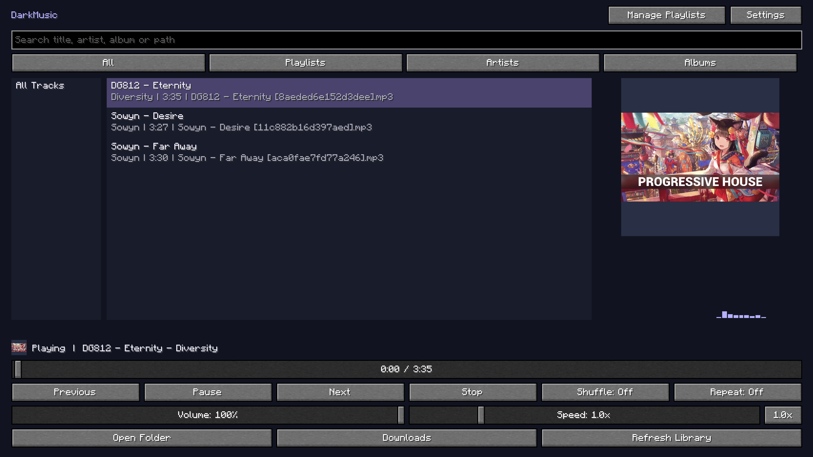
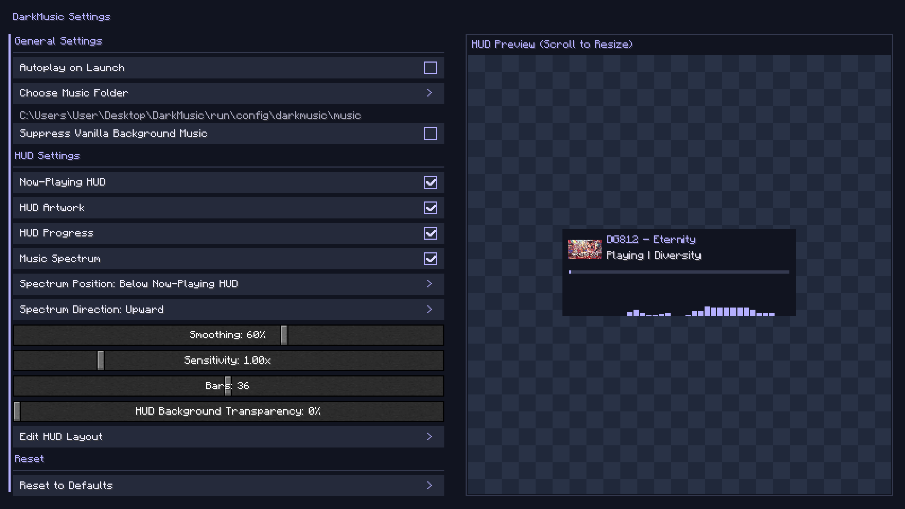
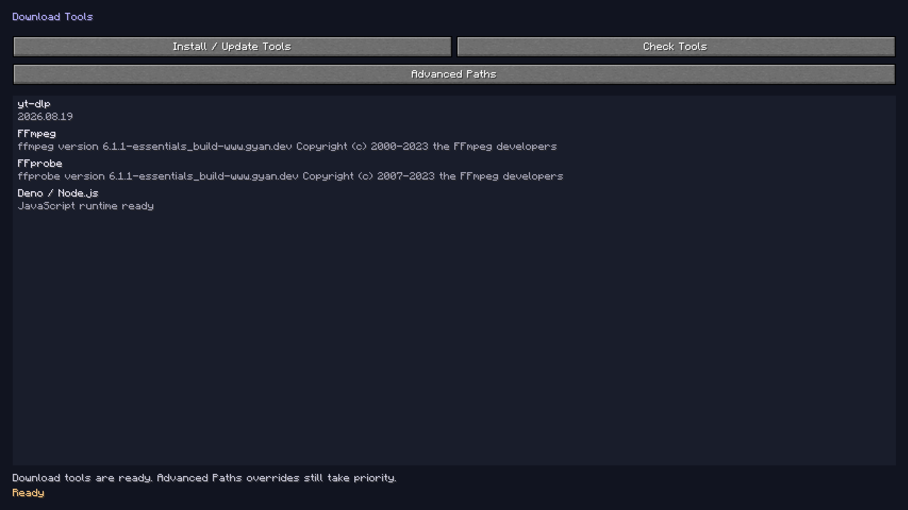

# DarkMusic user guide

[Project overview](../README.md) · [v1.0.2 release notes](RELEASE-1.0.2.md)

Open **Music** on the title screen or press **B** during gameplay. Hover for help. **Escape** returns; settings save automatically. Playback continues across menus and worlds.

## Music folders

The default is `config/darkmusic/music` inside the active instance. **Open Folder** opens the selected directory in your desktop file manager.

Choose **Settings → Choose Music Folder** to open a desktop folder chooser. Select a directory and approve it there. Cancel/Escape leaves the selection unchanged. Its path appears below the setting. No files are moved. Newly queued downloads use this folder; existing queue items keep their original destinations.

Subfolders are included. File watching checks every few seconds; a fallback scan runs every two minutes. Unchanged files reuse metadata. **Refresh Library** requests an immediate background scan.

| Extension | Audio |
|---|---|
| `.mp3` | MP3, including variable bitrate |
| `.ogg` | OGG Vorbis |
| `.wav` | PCM WAV |
| `.flac` | FLAC |

Use mono or stereo. OGG Opus and compressed WAV variants may need conversion.

## Browse and play

Search matches title, artist, album, and relative path. Choose **All**, **Playlists**, **Artists**, or **Albums**, then a group on the left. Compact layouts use a **View** selector. Double-click a song or press Enter with its list focused. Displayed results become the queue.

| Control | Behavior |
|---|---|
| Play / Pause / Resume | Start the selected song, pause, or resume |
| Previous / Next | Go back through history / advance through the queue |
| Stop | Stop and reset position |
| Progress | Preview while dragging; seek once on release |
| Volume | DarkMusic volume, separate from Minecraft sound sliders |
| Shuffle: Off / On | Original order / randomized order |
| Repeat: Off / One / All | Stop at end / repeat a song / repeat the queue |
| Speed | 0.5x–3.0x, in 0.1x steps |
| 1.0x | Reset speed to normal |

Speed changes tempo and pitch. Seeking uses the original song timeline. Manual Next advances even with repeat-one; only repeat-all wraps at the end. Compressed-file seeking may take a moment.

### Long text and keyboard navigation

Use the wheel vertically in lists. For overflowing titles, names, paths, and status messages, use horizontal trackpad scrolling or **Shift + wheel** over the text. Focused rows also support **Left / Right** panning. Input fields use caret scrolling; the selected folder path wraps.

Up/Down, Home/End, and Page Up/Page Down navigate focused lists. Enter plays in the main player. Tab moves between controls. The interface follows Minecraft's English or Traditional Chinese setting; supplied metadata is not translated.

### Metadata and artwork

Titles, artists, albums, and covers come from embedded tags. Missing titles use filenames; missing artist/album tags use the corresponding unknown label. Folder names are not invented as metadata.

Embed artwork using a tag editor, save, and refresh. Separate `cover.jpg` files are not loaded. Images retain aspect ratio with padding, without stretching/cropping. The cache preserves source resolution up to 1024 pixels and avoids upscaling small originals. Low-resolution artwork cannot gain detail from rendering.

## Playlists

Choose **Manage Playlists → New**, enter a name, and Save. Select the playlist, **Add Songs**, check songs, then **Add Selected**. Already-added songs are omitted from the picker. Playback controls remain in the main player.

| Selection action | Result |
|---|---|
| Checkbox | Toggle one song, retaining other checks |
| Row click | Select one song, clearing other checks |
| Ctrl/Cmd-click | Toggle one song |
| Shift-click | Select a connected range |
| Ctrl/Cmd+Shift-click | Add a range |
| Space / Enter with list focus | Toggle the focused entry |
| Shift+Up/Down | Extend selection |
| Ctrl/Cmd+A / Select All | Select visible songs |
| Deselect All | Clear all checks, including hidden selections |
| Invert Selection | Toggle visible checks while retaining hidden ones |

Search keeps selections. The count indicates songs hidden by filtering; Add Selected includes them. Cancel/Escape discards pending additions.

Use **Remove Selected**, **Move Up / Move Down**, **Rename**, or **Delete**. Delete opens a confirmation; Cancel/Escape preserves the playlist. Confirming deletes references only, never media.

Drag by a song's text to reorder. Connected selected songs move together in order; separate groups stay put. An insertion marker and animated rows show the destination. Hold near an edge to autoscroll. Escape or dropping outside cancels the drag. Remove missing entries and add their current files again if needed.

To listen, choose the playlist in the main player and play there. Browsing does not interrupt playback. Empty playlists stay empty; missing files are skipped and reported.

## Settings and combined HUD

One scrollable screen has General, HUD, and Reset sections. Rows use right-hand on/off checkboxes. A live preview appears beside or above the form.

General options are **Autoplay on Launch**, **Choose Music Folder**, and **Suppress Vanilla Background Music**. Autoplay and suppression default off. Suppression affects background music, not ordinary effects. Volume, speed, shuffle, and repeat remain in the player.

| Setting | Default and behavior |
|---|---|
| Now-Playing HUD | **On**; master visibility switch for the combined gameplay HUD |
| HUD Artwork | **On**; available embedded artwork |
| HUD Progress | **On**; progress below song information |
| Music Spectrum | **On**; bars in both player and HUD |
| Spectrum Position | **Below** information/progress; Above also available |
| Spectrum Direction | **Upward**; Downward inverts bar growth |
| Bars | **36**; 8–64 in steps of four, combined to fit narrow areas |
| Sensitivity | **1.0**; 0.25–4.0 visual gain |
| Smoothing | **60%**; higher values respond more slowly |
| HUD Background Transparency | **0%**; 0% opaque, 100% transparent |
| HUD scale | **100%** |
| Music volume | **100%**, adjusted in the player |

The master hides the complete gameplay HUD, including spectrum. Player bars remain available if Music Spectrum is enabled. The HUD respects F1 and hides in menus. Its spectrum shares width and scale; reserved spacing prevents bars from touching progress in either direction.

Transparency affects background surfaces, including artwork padding and spectrum space. Artwork, text, progress, bars, and main-menu artwork retain their opacity.

The preview updates immediately using the current song. With no song, preview information and preview-only sample bars show the layout. Gameplay bars always use decoded audio.

### Move and scale

- Scroll over the settings preview for independent scaling in 10% steps. A percentage readout helps compare sizes; this does not change actual HUD scale.
- Open **Edit HUD Layout**, drag the combined HUD, or scroll over it to resize in 10% steps from 50% to 300%.
- **Reset HUD Layout** restores top-left placement and 100% scale. Escape saves and returns.

All enabled components move/scale together. Relative positioning keeps the HUD visible across window sizes and GUI scales. The editor can preview it even when the gameplay master is off.

### Spectrum behavior

FFT uses decoded PCM after volume/speed processing. Analysis and smoothing run off the render thread and follow audio-device timing. Pause freezes bars; seek, stop, track changes, and errors clear old levels. Quiet audio/low volume produces shorter bars. Player bars use the area below artwork; HUD placement/direction settings affect the HUD only.

## Keyboard shortcuts

Change bindings in **Options → Controls → Key Binds → DarkMusic**.

| Action | Default |
|---|---|
| Open Music Player | B |
| Play / Pause Music | Backslash (`\`) |
| Previous / Next Song | `[` / `]` |
| Increase / Decrease Music Volume | Up Arrow / Down Arrow; 5% per press |
| Decrease / Increase Playback Speed | Left Arrow / Right Arrow; 0.1x per press |
| Mute / Unmute Music | M; restores the last audible volume |
| Reset Playback Speed | Numpad 0; return to 1.0x |

Shortcuts require gameplay with menus closed. Volume, mute, and speed changes show brief fading notices. Conflicting bindings are disabled until assigned a free key. Keys are ordinary keys, not special media buttons. Reassign Reset Playback Speed if your keyboard lacks a numeric keypad.

Saved choices, including unbound keys, survive updates. New installs and **Reset to Defaults** use the fixed defaults above. Minecraft's Reset control can restore individual bindings.

## Download music

### Tools

Open **Downloads → Tools**. Each tool has a separate row and checked version/status:

| Tool | Purpose and source |
|---|---|
| yt-dlp | [Extraction and supported sites](https://github.com/yt-dlp/yt-dlp) |
| FFmpeg | [MP3 conversion, metadata/artwork](https://ffmpeg.org/) |
| FFprobe | [Output validation](https://ffmpeg.org/ffprobe.html) |
| Deno / Node.js | [Deno](https://deno.com/) or [Node.js](https://nodejs.org/) for YouTube JavaScript |

**Install / Update Tools** explicitly installs a managed yt-dlp, FFmpeg/FFprobe, and Deno bundle. Published checksums are verified before use; the previous bundle stays active until a replacement validates. Bundles live in `config/darkmusic/tools/managed`. Managed FFmpeg comes from [ffmpeg-static releases](https://github.com/eugeneware/ffmpeg-static/releases); publisher/release metadata and notices are retained. Availability depends on detected OS/architecture and published assets.

**Advanced Paths** supports existing executables. Blank paths search the managed bundle, instance tools, and system PATH; FFprobe can also be found beside FFmpeg. FFmpeg needs `libmp3lame`. YouTube needs Deno 2.3+ or Node.js 22+. Official standalone yt-dlp includes challenge scripts; see [EJS setup](https://github.com/yt-dlp/yt-dlp/wiki/EJS) for other distributions.

**Check Tools** validates versions and MP3 support. **Cancel Tool Operation** appears only during checking/installing and stops that work. Escape only leaves the menu. There is no Done button. Nothing installs on startup; local playback needs none of these tools.

### Analyze and select

Paste a URL and **Analyze** before downloading. Leaving Downloads clears entries/checks while remembering the last analyzed URL for the current client session. Re-entering requires fresh analysis.

| Mode | Selection |
|---|---|
| This Video Only | One video, even if its watch URL includes a playlist; default for a single result |
| Selected Entries | Checked entries across loaded pages |
| Entry Range | Inclusive start/end; use 1–N for the first N |
| All Entries | Explicitly choose the known collection size |

Switching modes clears checks. Range mode uses its inputs, ignores checks, and disables row checking. A collection-only URL cannot silently download everything through This Video Only. **Queue / Entries** switches views.

Search filters the loaded page without fetching more entries. Pages contain up to 100 entries; **Previous Page / Next Page** navigate. **Select Page** checks visible entries; **Deselect All** clears all pages. A batch/queue holds up to 1,000 entries; use ranges for larger collections. Dynamic Mixes need bounded ranges or checked entries.

YouTube videos/playlists/Mixes, Bilibili videos/collections/favorites/series/multipart videos, and other supported sites depend on yt-dlp and source availability. Use a part-specific URL for one Bilibili part. Private, deleted, restricted, or unsupported entries may fail. DarkMusic does not bypass authentication, DRM, or access controls.

### Listen before downloading

Select an entry and **Play Audio Preview** to fetch up to 30 seconds. Double-clicking also starts a preview. **Stop Audio Preview**, changing page/mode, switching to Queue, or leaving stops it. Main playback pauses/resumes where appropriate. Clips are temporary; successful queue downloads are permanent.

### Queue and files

The queue reports waiting, downloading, converting, saved, skipped, failed, and cancelled states, available progress, and overall finished/failed counts. **Cancel Selected** stops one item; **Cancel All** also cancels analysis. **Clear Finished** only removes rows. Closing the menu keeps downloads running; exiting Minecraft cancels unfinished work. Queue rows are not restored after restart.

MP3s are verified before entering the selected folder. Available title, artist/uploader, album, track number, and thumbnail artwork are embedded. Collection position supplies track number when no explicit tag exists; missing artist/album information is not invented. Unusable artwork can produce an audio-only MP3 with a warning.

Stable identifiers avoid collisions. `.darkmusic-downloads.json` records completed downloads for duplicate detection while their files exist. Keep it for deduplication; resetting clears it without deleting songs, allowing the same source to be queued again. Saved music triggers a background refresh and remains playable after restart.

Individual failures do not stop later items. For 403, check access and tool versions. For 429, wait before retrying. Check free space in both instance and music directories for conversion/filesystem errors. Logs retain diagnostics; malformed history is preserved.

## Reset to defaults

Choose **Settings → Reset to Defaults**. Confirmation explains the scope, with Cancel initially focused. Cancel/Escape leaves data unchanged before confirmation. Once confirmed, wait for completion.

Reset stops playback/audition/downloads, restores all DarkMusic preferences/native keys, resets actual/preview HUD scales, switches to the default folder, clears recognized history/caches, and removes recognized instance-local tool executables. This includes legacy `downloaded.txt` records in known music folders.

**Audio/video files, downloaded music, playlists, and external tools stay untouched.** No music folder is moved or recursively deleted. Playlist folder identities remain so reselecting an old collection restores matching. Unknown, linked, or inaccessible files are retained/reported; another client actively using tools/downloads prevents cleanup. Caches rebuild as needed. Unrelated Minecraft options/key binds are unchanged.

## Troubleshooting and persistence

| Symptom | Try |
|---|---|
| Empty library | Check path, formats, search/view, and Refresh Library |
| Missing tags/artwork | Embed tags/artwork, save, and refresh |
| Missing playlist song | Reconnect its original folder, or remove/add the current file |
| Add Songs is empty | Already-added songs are omitted; clear search or refresh |
| HUD invisible | Enable master, play music, close menus, check F1, or reset layout |
| Shortcut does nothing | Close menus and resolve conflicts |
| No sound | Check mute, volume, output device, playback status |
| Unexpected pitch | Return speed to 1.0x |
| Tool error | Check separate tool rows, paths, network, platform support, and logs |

Transient warnings expire after ten seconds; ongoing errors remain in status. Settings/playlists are `config/darkmusic/config.json` and `playlists.json`. Close Minecraft before copying them between instances. Native key binds are in Minecraft's `options.txt`.

[Project overview](../README.md)
